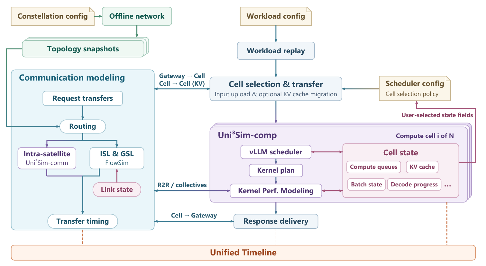

<p align="center">
  <picture>
    <source media="(prefers-color-scheme: dark)" srcset="assets/astermind-readme-lockup-dark.png">
    
  </picture>
</p>

<p align="center">
  <a href="doc/AsterMind-V1-Tech-Report.pdf"><strong>Technical Report</strong></a> · <a href="https://guanyu-tech.github.io/AsterMind/en/"><strong>Project Homepage</strong></a>
</p>

<p align="center">
  English · <a href="README.zh-CN.md" lang="zh-CN">简体中文</a>
</p>

<h1 align="center">AsterMind V1: Exploring Space Intelligence</h1>

AsterMind is an extensible system-level simulator for space computing. It evaluates in-orbit large language model (LLM) serving across single satellites, compute formations, and full constellations. It models orbital motion, communication, and compute together, following requests from ground ingress through satellite forwarding, queuing, and inference to response delivery on the ground.

Developers can configure workloads and constellation scenarios to compare link establishment, routing, scheduling, and model deployment strategies under orbital operating constraints. This supports end-to-end performance evaluation and helps identify what limits serving performance.

## Key Features

- **End-to-end simulation across deployment scales.** AsterMind supports single-satellite, satellite formation, and constellation-scale scenarios within a common simulation framework. It supports the simulation of end-to-end request execution on a shared event timeline.
- **Multi-dimensional state modeling.** Building on the scenario generated by the offline constellation builder, AsterMind jointly models orbital dynamics, computation, and communication. It captures how the time-varying connectivity, bandwidth contention, compute load, and session-state reuse interact throughout request execution.
- **Configurable scenarios and extensible policies.** Users can construct scenarios by specifying constellation layouts, hardware resources and workloads. They can also define and integrate custom deployment, routing, and scheduling policies to explore new strategies and compare alternative designs.

## Overview



The **offline constellation builder** computes satellite positions and ground-to-satellite and inter-satellite link conditions at configured intervals. It records topology snapshots with link capacities and propagation delays so the runtime can look up available access satellites and forwarding paths.

The **state-coupled runtime engine** replays requests at their recorded arrival times and ingress gateways, selects compute cells and routes, and simulates KV cache migration as needed. Once the inputs arrive, requests queue for batching. When a batch completes, the engine updates request progress and KV cache state, then simulates response delivery to the ground gateway.

## Build and Install

### Windows x64

[Download the AsterMind v1.0 Windows x64 installer](https://github.com/GUANYU-Tech/AsterMind/releases/download/v1.0.0-preview.7/AsterMind-v1.0-Windows-x64-Setup.exe) (prerelease `1.0.0-preview.7`).

### Linux source installation

**Prerequisites.** x86-64 Linux with glibc 2.39 or newer, Git, a C/C++ toolchain, and `libnuma.so.1`. Python 3.12 is required. The examples run on the CPU without model weights or a GPU.

```bash
git clone https://github.com/GUANYU-Tech/AsterMind.git
cd AsterMind

bash scripts/install-ubuntu-deps.sh
python3.12 -m venv .venv
source .venv/bin/activate
```

Install the Python dependencies and build AsterMind. Building the frontend requires Node.js and npm.

```bash
python -m pip install -r requirements.txt
bash scripts/build.sh
```

## Quick Start

### Open the Frontend

Start the local service. The 3D previews require a browser with WebGL 2.

```bash
bash scripts/run.sh
```

Open the [local simulation homepage](http://localhost:8766/en/).

| Simulation scope | Frontend | Example |
| --- | --- | --- |
| **L2 · Single Cell** | [Compute Formation Simulation](http://localhost:8766/cell/) | [DeepSeek-V4-Pro](#l2--deepseek-v4-pro-example) |
| **L3 · Constellation** | [End-to-End Simulation](http://localhost:8766/workspace) | Example pending. |

### L2 · DeepSeek-V4-Pro Example

Run **DeepSeek-V4-Pro** in **Detail Mode** with **TP8 × PP4** across four satellites with eight simulated H200 GPUs each.

1. Open [Compute Formation Simulation](http://localhost:8766/cell/), switch to **EN**, and select **New Task**.
2. In **Constellation Resources**, select **NVIDIA H200**, **four satellites**, and **eight GPUs per satellite**. Set the formation to **Ring** with **1 km** spacing.
3. In **Communication Network**, use one **eight-GPU SU group per satellite** and set the inter-satellite links to **Fixed-Bandwidth Mode** at **400 Gbps**.
4. In **Model and Workload**, select **deepseek-v4-pro** and **Detail Mode**. Set two synthetic requests at **16 requests/s**, each with **16 input tokens** and **2 output tokens**.
5. In **Parallel Deployment**, select **Colocated** and **Manual Configuration**. Set **TP 8, PP 4, DP 1** with EP off. Map each pipeline stage to a separate satellite.
6. In **Scheduling and Execution**, set **Maximum Model Context Length** to **1152 tokens** and turn off **Chunked Prefill**. Select **Submit Task**. Open **Simulation Results** to view both requests and their compute and communication timelines.

### L3 · Constellation Simulation Example

Sample dataset and run instructions pending.

## Contributing

Bug reports, fixes, and runnable scenarios are welcome. For an issue, include your AsterMind commit, scenario or minimal input, run command, and expected and observed behavior. For a pull request, describe the change and include the checks you ran.

## Contact

- **Lidong Guo** · [guolidong@guanyu.cn](mailto:guolidong@guanyu.cn)
- **Zhenhua Zhu** · [zhuzhenhua@mail.tsinghua.edu.cn](mailto:zhuzhenhua@mail.tsinghua.edu.cn)
