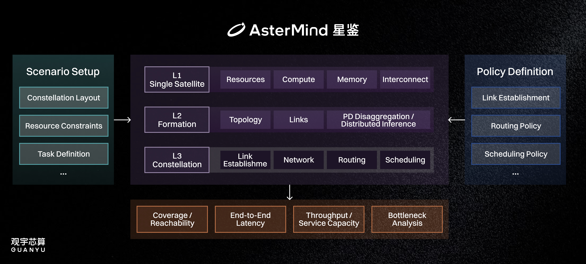

<p align="center">
  <picture>
    <source media="(prefers-color-scheme: dark)" srcset="assets/astermind-readme-lockup-dark.png">
    
  </picture>
</p>

<p align="center">
  <a href="doc/AsterMind-V1-Tech-Report.pdf"><strong>Technical Report</strong></a> · <a href="https://guanyu-tech.github.io/AsterMind/en/"><strong>Project Homepage</strong></a>
</p>

<p align="center">
  English · <a href="README.zh-CN.md" lang="zh-CN">简体中文</a>
</p>

<h1 align="center">AsterMind V1: Exploring Space Intelligence</h1>

AsterMind is an extensible system-level simulator for space computing. It evaluates in-orbit large language model (LLM) serving across single satellites, compute formations, and full constellations. It models orbital motion, communication, and compute together, following requests from ground ingress through satellite forwarding, queuing, and inference to response delivery on the ground.

Developers can configure workloads and constellation scenarios to compare link establishment, routing, scheduling, and model deployment strategies under orbital operating constraints. This supports end-to-end performance evaluation and helps identify what limits serving performance.

<p align="center">
  <picture>
    <source media="(prefers-color-scheme: dark)" srcset="assets/astermind-overview-en.png">
    
  </picture>
</p>

## Key Features

- **End-to-end simulation across deployment scales.** AsterMind supports single-satellite, satellite formation, and constellation-scale scenarios within a common simulation framework. It supports the simulation of end-to-end request execution on a shared event timeline.
- **Multi-dimensional state modeling.** Building on the scenario generated by the offline constellation builder, AsterMind jointly models orbital dynamics, computation, and communication. It captures how the time-varying connectivity, bandwidth contention, compute load, and session-state reuse interact throughout request execution.
- **Configurable scenarios and extensible policies.** Users can construct scenarios by specifying constellation layouts, hardware resources and workloads. They can also define and integrate custom deployment, routing, and scheduling policies to explore new strategies and compare alternative designs.

## Overview


The **offline constellation builder** computes satellite positions and ground-to-satellite and inter-satellite link conditions at configured intervals. It records topology snapshots with link capacities and propagation delays so the runtime can look up available access satellites and forwarding paths.

The **state-coupled runtime engine** replays requests at their recorded arrival times and ingress gateways, selects compute cells and routes, and simulates KV cache migration as needed. Once the inputs arrive, requests queue for batching. When a batch completes, the engine updates request progress and KV cache state, then simulates response delivery to the ground gateway.

## Build and Install

### Windows (64-bit)

[Download the AsterMind Windows x64 installer](https://github.com/GUANYU-Tech/AsterMind/releases/latest/download/AsterMind-Windows-x64-Setup.exe).

### macOS (Apple Silicon)

The Apple Silicon installer is in preparation, with macOS 13 or later as the compatibility target.

### Linux source installation

**Prerequisites.** x86-64 Linux with glibc 2.39 or newer, Git, a C/C++ toolchain, and `libnuma.so.1`. Python 3.12 is required.

```bash
git clone https://github.com/GUANYU-Tech/AsterMind.git
cd AsterMind

bash scripts/install-ubuntu-deps.sh
python3.12 -m venv .venv
source .venv/bin/activate
```

Install the Python dependencies and build AsterMind. Building the frontend requires Node.js and npm.

```bash
python -m pip install -r requirements.txt
bash scripts/build.sh
```

## Quick Start

### Open AsterMind Frontend

Start the local service. The 3D previews require a browser with WebGL 2.

```bash
bash scripts/run.sh
```

Then open the AsterMind frontend [http://localhost:8766/en/](http://localhost:8766/en/).

<p align="center">
  <picture>
    <source media="(prefers-color-scheme: dark)" srcset="assets/astermind-frontend-en.jpg">
    
  </picture>
</p>
<h1 align="center"></h1>

### Compute Formation Simulation

In **Detail Mode**, this example simulates distributed inference for **DeepSeek-V4-Pro** using a **TP8 × PP4** parallel configuration across four satellites, each equipped with eight NVIDIA H200 GPUs.

1. Open 「Compute Formation Simulation」 and select 「New Task」.
2. In 「Constellation Resources」, select **NVIDIA H200** and set **4 satellites with 8 GPUs per satellite**. Set the static formation to Ring with **1 km** spacing.
3. In 「Communication Network」, use **one eight-GPU SU group** per satellite and set the inter-satellite links to 「Fixed-Bandwidth Mode」 at **400 Gbps**.
4. In 「Model and Workload」, select **DeepSeek-V4-Pro** and **Detail Mode**. Configure **2 synthetic requests**, set 「Arrival Distribution」 to `constant`, and set the arrival rate to **16 requests/s**, with **20 input tokens** and **2 output tokens** per request.
5. In 「Parallel Deployment」, select 「Colocated」. Set **TP 8, PP 4, DP 1** and turn off **EP**. Click 「Regenerate Accelerator Mapping」 to place each pipeline stage on a separate satellite.
6. In 「Scheduling and Execution」, set 「Max Requests per Batch」 to **16** and turn off 「Chunked Prefill」. Click 「Submit Task」, then open 「Simulation Results」 to view both requests and their compute and communication timelines.

### Constellation simulation

**Fast Mode · 6,000 communications satellites · 10 compute formations · 5 gateways · 168 requests**

Simulate global inference serving with GLM-5.2 at TP8 × PP4 per formation. A 360 s simulation replays 300 s of arrivals and gives in-flight requests 60 s to continue. The topology updates every 60 s.

1. **Build the topology.** Open **End-to-End Simulation → New Task** and select **New Physical Model** in **Setup**. Apply the topology settings below. Remove the default ground stations, then import the [gateway CSV](examples/L3_Quick_Start/gateways-quick-start.csv) and select **Append to this scenario**. Confirm **5 gateways**, then select **Generate Data and Continue**.
2. **Run the workload.** In **Configure Scenario**, select the generated **Physical Topology Dataset**, confirm **10 Cells**, and apply the routing settings below. In **Service Requests → Batch Import**, import the [300-second request trace](examples/L3_Quick_Start/wildchat-1x-quick-start-300s.jsonl) as JSONL with **Replace Current Requests**. Select **Validate and Preview**, confirm **168 requests**, then select **Apply Requests** and **Run Experiment and View Results**.
3. **Inspect the results.** In **Request Performance**, check the target Cell, completion status, and gateway-side TTFT, TPOT, and end-to-end latency. In **Scene Replay → Play Replay**, follow a request from uplink to response delivery in 3D.

<details>
<summary>Exact scenario settings</summary>

Leave **Physical model source** blank. Remove unused default constellations and keep unlisted settings at their defaults.

| Panel | Settings |
| --- | --- |
| Physical Scenario | Start `2026-11-20T00:00:00Z`, duration 360 s, geometry time step 60 s |
| Communications Constellation | **Generate from parameters → Walker Parameters**. Altitude 550 km, 60 planes × 100 satellites, inclination 53°, phase 1, initial RAAN 0°, initial argument of latitude 0°. Use **Grid / 4 Neighbors** and **Custom Hardware** with 6 ISL terminals and at most 1 ground link per satellite. |
| Compute Constellations and Cells | Create a **Fast Mode** constellation with 10 Cells. Edit one Cell using the next three rows, then select **Use as Template for All 10 Cells**. |
| Cell resources and network | 4 satellites in a ring, 1 km spacing, 800 km altitude, 8 H200 GPUs per satellite and 8 GPUs per SU group |
| Cell model and deployment | GLM-5.2, 70% compute efficiency, 96% HBM bandwidth efficiency, **Colocated**, TP8 × PP4, EP off, DP1 |
| Cell scheduling and cache | 32 requests per batch, **Chunked Prefill** on, **Prefill Chunk Limit** `0` (use the remaining batch token budget), **Prefix Caching** on |
| Constellation Orbit and Access Settings | **Dawn–Dusk Sun-Synchronous Orbit**, **Single-Satellite Egress**, access member index `0`, 2 external ISL terminals per access member |
| Ground Stations and Access | Remove the default ground stations, then use **Import ground stations from CSV** to add Guangzhou, New Delhi, Johannesburg, Frankfurt, and Los Angeles. It sets the coordinates, 25° minimum elevation, and 16 terminals per station. Set **Ground Node Role** to **RF Gateway Backhaul**. |
| Connectivity and Link Budgets | Disable direct links between Cells, select **Fixed bandwidth**, use the values below, and leave effective bandwidth at 100%. |
| Routing and Scheduling | **Shortest Total Path** for routing and **Shortest Distance** for Cell selection |

| Link | Limit per direction (bps) | Max distance (km) | Setup (s) |
| --- | ---: | ---: | ---: |
| Communications satellite ↔ communications satellite | `400000000000` | 4000 | 2 |
| Compute satellite ↔ communications satellite | `400000000000` | 4000 | 2 |
| Within a Cell | `1000000000000` | 10 | 2 |
| Ground ↔ satellite | `1000000000` | 2500 | 2 |

</details>

## Contribution Guidelines
We welcome contributions to AsterMind. Before opening a pull request, read the [contribution guide](CONTRIBUTING.md). Thank you to everyone who contributes to the project.

## Acknowledgements

We thank the teams at Tsinghua University and Infinigence AI for open-sourcing [Uni3Sim](https://github.com/thu-nics/uni3sim). AsterMind V1.0 draws on Uni3Sim’s simulation methods in its compute and inter-accelerator communication modules.

## Contact

- **Lidong Guo** : [guolidong@guanyu.cn](mailto:guolidong@guanyu.cn)
- **Zhenhua Zhu** : [zhuzhenhua@mail.tsinghua.edu.cn](mailto:zhuzhenhua@mail.tsinghua.edu.cn)
