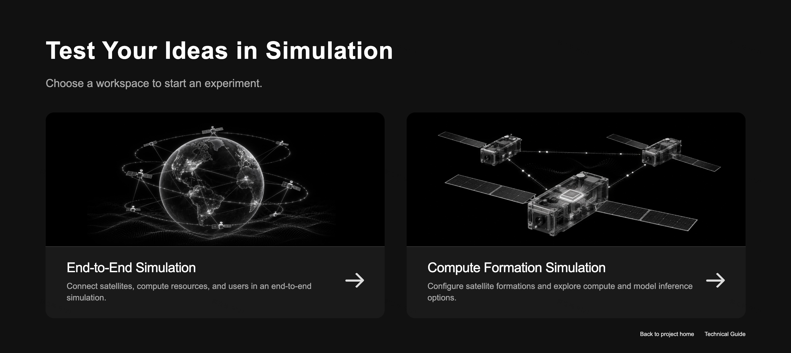

<p align="center">
  <picture>
    <source media="(prefers-color-scheme: dark)" srcset="assets/astermind-readme-lockup-dark.png">
    
  </picture>
</p>

<p align="center">
  <a href="doc/AsterMind-V1-Tech-Report.pdf"><strong>Technical Report</strong></a> · <a href="https://guanyu-tech.github.io/AsterMind/en/"><strong>Project Homepage</strong></a>
</p>

<p align="center">
  English · <a href="README.zh-CN.md" lang="zh-CN">简体中文</a>
</p>

<h1 align="center">AsterMind V1: Exploring Space Intelligence</h1>

AsterMind is an extensible system-level simulator for space computing. It evaluates in-orbit large language model (LLM) serving across single satellites, compute formations, and full constellations. It models orbital motion, communication, and compute together, following requests from ground ingress through satellite forwarding, queuing, and inference to response delivery on the ground.

Developers can configure workloads and constellation scenarios to compare link establishment, routing, scheduling, and model deployment strategies under orbital operating constraints. This supports end-to-end performance evaluation and helps identify what limits serving performance.

<p align="center">
  <picture>
    <source media="(prefers-color-scheme: dark)" srcset="assets/astermind-overview-en.png">
    
  </picture>
</p>

## Key Features

- **End-to-end simulation across deployment scales.** AsterMind supports single-satellite, satellite formation, and constellation-scale scenarios within a common simulation framework. It supports the simulation of end-to-end request execution on a shared event timeline.
- **Multi-dimensional state modeling.** Building on the scenario generated by the offline constellation builder, AsterMind jointly models orbital dynamics, computation, and communication. It captures how the time-varying connectivity, bandwidth contention, compute load, and session-state reuse interact throughout request execution.
- **Configurable scenarios and extensible policies.** Users can construct scenarios by specifying constellation layouts, hardware resources and workloads. They can also define and integrate custom deployment, routing, and scheduling policies to explore new strategies and compare alternative designs.

## Overview


The **offline constellation builder** computes satellite positions and ground-to-satellite and inter-satellite link conditions at configured intervals. It records topology snapshots with link capacities and propagation delays so the runtime can look up available access satellites and forwarding paths.

The **state-coupled runtime engine** replays requests at their recorded arrival times and ingress gateways, selects compute cells and routes, and simulates KV cache migration as needed. Once the inputs arrive, requests queue for batching. When a batch completes, the engine updates request progress and KV cache state, then simulates response delivery to the ground gateway.

## Build and Install

### Windows (64-bit)

[Download the AsterMind v1.0 Windows x64 installer](https://github.com/GUANYU-Tech/AsterMind/releases/download/v1.0.0-preview.9/AsterMind-v1.0-Windows-x64-Setup.exe).

### macOS (Apple Silicon)

The Apple Silicon installer is in preparation, with macOS 13 or later as the compatibility target.

### Linux source installation

**Prerequisites.** x86-64 Linux with glibc 2.39 or newer, Git, a C/C++ toolchain, and `libnuma.so.1`. Python 3.12 is required.

```bash
git clone https://github.com/GUANYU-Tech/AsterMind.git
cd AsterMind

bash scripts/install-ubuntu-deps.sh
python3.12 -m venv .venv
source .venv/bin/activate
```

Install the Python dependencies and build AsterMind. Building the frontend requires Node.js and npm.

```bash
python -m pip install -r requirements.txt
bash scripts/build.sh
```

## Quick Start

### Open AsterMind Frontend

Start the local service. The 3D previews require a browser with WebGL 2.

```bash
bash scripts/run.sh
```

Then open the AsterMind frontend [http://localhost:8766/en/](http://localhost:8766/en/).

<p align="center">
  <picture>
    <source media="(prefers-color-scheme: dark)" srcset="assets/astermind-frontend-en.jpg">
    
  </picture>
</p>
<h1 align="center"></h1>

### Compute Formation Simulation

In **Detail Mode**, this example simulates distributed inference for **DeepSeek-V4-Pro** using a **TP8 × PP4** parallel configuration across four satellites, each equipped with eight NVIDIA H200 GPUs.

1. Open 「Compute Formation Simulation」 and select 「New Task」.
2. In 「Constellation Resources」, select **NVIDIA H200** and set **4 satellites with 8 GPUs per satellite**. Set the static formation to Ring with **1 km** spacing.
3. In 「Communication Network」, use **one eight-GPU SU group** per satellite and set the inter-satellite links to 「Fixed-Bandwidth Mode」 at **400 Gbps**.
4. In 「Model and Workload」, select **DeepSeek-V4-Pro** and **Detail Mode**. Configure **2 synthetic requests**, set 「Arrival Distribution」 to `constant`, and set the arrival rate to **16 requests/s**, with **20 input tokens** and **2 output tokens** per request.
5. In 「Parallel Deployment」, select 「Colocated」. Set **TP 8, PP 4, DP 1** and turn off **EP**. Click 「Regenerate Accelerator Mapping」 to place each pipeline stage on a separate satellite.
6. In 「Scheduling and Execution」, set 「Max Requests per Batch」 to **16** and turn off 「Chunked Prefill」. Click 「Submit Task」, then open 「Simulation Results」 to view both requests and their compute and communication timelines.

### Constellation simulation

This example uses **Fast Mode** to simulate a **global inference service** at constellation scale. It replays **300 seconds of global request traffic**, with **168 requests** arriving through **five ground gateways** in Asia, Africa, Europe, and North America. The physical scenario includes **6,000 communications satellites** and **10 compute formations** with **40 compute satellites** in total. Each formation runs **GLM-5.2** with **TP8 × PP4** parallelism. The simulation runs for **360 seconds** and updates the topology every **60 seconds**. Requests that have already arrived can continue processing during the final 60 seconds.

#### Physical Scenario

1. Open 「End-to-End Simulation」 and select 「New Task」. In 「Setup」, select 「New Physical Model」.
2. In 「Physical Scenario」, enter a model name. Set the experiment start time (UTC) to `2026-11-20T00:00:00Z`, the simulation duration to **360 s**, and the geometry time step to **60 s**. 「Physical model source」 loads a previously configured scenario. Leave it blank when setting up a new one.
3. In 「Communications Constellation」, use the 「−」 button in the upper-right corner of each card to remove unused default constellations. Select 「Add communications constellation → Generate from parameters」, then choose 「Walker Parameters」.
   - Set the altitude to **550 km**. Use **60 orbital planes with 100 satellites per plane**. Then set the inclination to **53°**, the Walker phase to **1**, and both the initial RAAN and the initial argument of latitude to **0**.
   - After adding the constellation, set 「Inter-Satellite Topology」 to **Grid / 4 Neighbors**.
   - Set 「Communications Satellite Hardware Preset」 to 「Custom Hardware」. In 「Advanced Hardware Settings (Manual)」, set **6 ISL terminals** and set Max Ground Links per Satellite to **1**.
   - Scroll back to the top and select 「Compute Constellations and Cells」 next to the highlighted 「Communications Constellation」 tab.
4. In 「Compute Constellations and Cells」, select **Fast Mode**. Use the 「−」 button in the upper-right corner of each 「Compute Constellation」 card to remove unused default constellations. Select 「Add Compute Constellation」, enter a constellation ID, set the number of Cells to **10**, and select Add Constellation.
5. In the constellation's 「Compute Cells」 card, select 「Edit Cell」 on any Cell.
   - In 「Constellation Resources」, set the physical resources to **8 H200 GPUs per satellite**. For constellation geometry, set **4 satellites in a Ring with 1 km spacing at an altitude of 800 km**. Open 「Communication Network」.
   - In 「Communication Network」, keep the defaults, including 8 GPUs per scale-up (SU) group. Open 「Model and Workload」.
   - In 「Model and Workload」, select **GLM-5.2**. Under 「Roofline parameters」, set compute efficiency to **70%** and HBM bandwidth efficiency to **96%**.
   - In 「Parallel Deployment」, select 「Colocated」. Set **TP8 × PP4**, turn off EP, and set DP to 1. Open 「Scheduling and Execution」.
   - In 「Scheduling and Execution」, set a limit of **32 requests per batch** and enable 「Chunked Prefill」. Keep 「Prefill Chunk Limit」 at its default of **0** so the scheduler can size each chunk using the remaining batch token budget.
   - Under 「KV Cache Config」, **enable Prefix Caching**.
   - After configuring one Cell, select 「Use as Template for All 10 Cells」 to return to the physical scenario.
6. Scroll to the bottom and expand 「Constellation Orbit and Access Settings」.
   - Set 「Orbit Source」 to **Dawn–Dusk Sun-Synchronous Orbit** and 「Cell Egress Mode」 to **Single-Satellite Egress**. Set 「Access member indices」 to **0** and 「External ISL terminals per access member」 to **2**.
   - Keep the remaining settings at their defaults.
   - Scroll back to the top and select 「Ground Stations」 next to the highlighted 「Compute Constellations and Cells」 tab.

7. In 「Ground Stations and Access」, use the 「−」 button in the upper-right corner of each card to remove the default ground stations. Expand 「Import ground stations from CSV」.
   - Upload the [sample gateway CSV](examples/L3_Quick_Start/gateways-quick-start.csv) and click 「Append to this scenario」. Confirm that the list contains **five gateways** (Guangzhou, New Delhi, Johannesburg, Frankfurt, and Los Angeles). The CSV supplies the coordinates, a minimum elevation of **25°**, and **16 terminals per station**. Set Ground Node Role to **RF Gateway Backhaul**.
   - Keep the remaining settings at their defaults.
   - Scroll back to the top and select 「Connectivity and Link Budgets」 next to the highlighted 「Ground Stations」 tab.
8. In 「Connectivity and Link Budgets」, disable direct links between Cells, set 「Inter-Satellite Link Calculation Model」 to **Fixed bandwidth**, and enter the values below. Under 「Link Bandwidth Contention (Fast Mode)」, you can adjust the effective bandwidth ratio for each link type. The default is 100%. Click 「Generate Data and Continue」. When the physical model is ready, the application opens 「Configure Scenario」.

   | Link type | Per-direction limit (bps) | Maximum distance (km) | Link setup time (s) |
   | --- | ---: | ---: | ---: |
   | Communications satellite to communications satellite | `400000000000` | 4000 | 2 |
   | Compute satellite to communications satellite | `400000000000` | 4000 | 2 |
   | Within a Cell | `1000000000000` | 10 | 2 |
   | Ground-to-satellite link budget | `1000000000` | 2500 | 2 |

#### Workload and Execution

1. In 「Configure Scenario」, enter a scenario name and select the physical scenario you just generated from 「Physical Topology Dataset」. Under 「Routing and Scheduling」, set 「Routing Policy」 to **Shortest Total Path** and 「Cell Selection Policy」 to **Shortest Distance**. Confirm that 「Compute Cells in the Physical Scenario」 lists **10 Cells**.
2. Scroll to the bottom. In 「Service Requests」, select 「Batch Import」 and upload the [300-second sample request trace](examples/L3_Quick_Start/wildchat-1x-quick-start-300s.jsonl). Select **JSONL** as the format and 「Replace Current Requests」 under 「Apply Mode」. Click 「Validate and Preview」, confirm there are **168 requests**, and click 「Apply Requests」. Keep the remaining settings at their defaults.
3. Click 「Run Experiment and View Results」.

#### Run and Replay

1. When the run finishes, open 「Request Performance」 to view each request's target Cell, completion status, and gateway-side TTFT, TPOT, and end-to-end latency. In 「Scene Replay」, click 「Play Replay」 or step through the recorded events to inspect request upload paths and response return paths in 3D.
2. Select 「Run History」 in the left sidebar to view past experiments.

## Contribution Guidelines
We welcome contributions to AsterMind. Before opening a pull request, read the [contribution guide](CONTRIBUTING.md). Thank you to everyone who contributes to the project.

## Acknowledgements

We thank the teams at Tsinghua University and Infinigence AI for open-sourcing [Uni3Sim](https://github.com/thu-nics/uni3sim). AsterMind V1.0 draws on Uni3Sim’s simulation methods in its compute and inter-accelerator communication modules.

## Contact

- **Lidong Guo** : [guolidong@guanyu.cn](mailto:guolidong@guanyu.cn)
- **Zhenhua Zhu** : [zhuzhenhua@mail.tsinghua.edu.cn](mailto:zhuzhenhua@mail.tsinghua.edu.cn)
