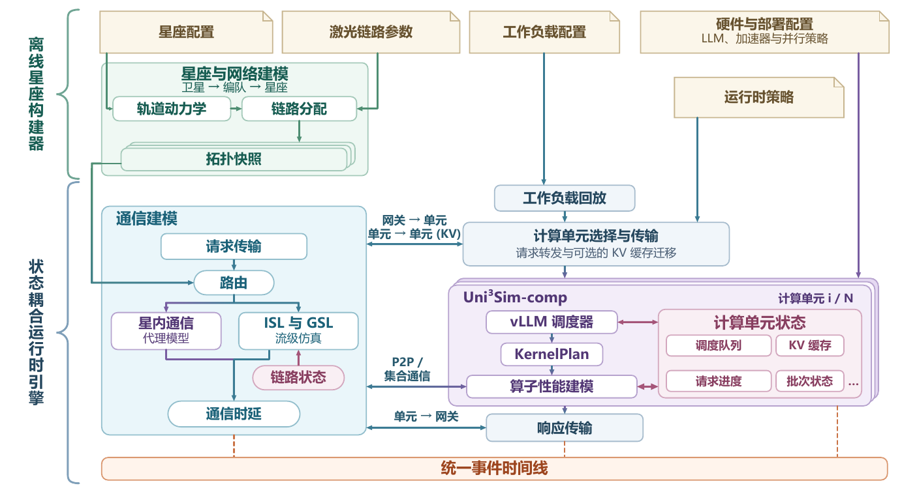

<p align="center">
  <picture>
    <source media="(prefers-color-scheme: dark)" srcset="assets/astermind-readme-lockup-dark.png">
    
  </picture>
</p>

<p align="center">
  <a href="doc/AsterMind-V1-Tech-Report.pdf"><strong>Technical Report</strong></a> · <a href="https://guanyu-tech.github.io/AsterMind/"><strong>Project Homepage</strong></a>
</p>

<p align="center">
  <a href="README.md" lang="en">English</a> · 简体中文
</p>

<h1 align="center">AsterMind V1: Exploring Space Intelligence</h1>

AsterMind 是一个可扩展的星座级太空智算系统仿真平台，为在轨大语言模型服务提供从单星、算力编队到完整星座的系统级评估工具。平台联合建模轨道运动、通信和计算，模拟地面请求接入、卫星转发、排队执行和结果回传的全过程。

开发者可以配置业务负载和星座场景，在星载环境约束下比较不同的建链、路由、任务调度和模型部署策略，评估端到端性能并定位影响服务表现的关键因素。

## 核心特性

- **覆盖不同尺度的全链路仿真。** 支持单星、算力编队和完整星座场景，评估各尺度下的设计与优化方案。
- **轨道、通信与计算联合仿真。** 在同一仿真过程中跟踪卫星位置、可见窗口、建链和路由，并模拟传输时延、带宽竞争、计算排队和模型执行。
- **可配置、可扩展的开放验证。** 支持配置星座构型、硬件资源、链路参数、模型部署和业务负载，并在建链、路由、请求调度和状态迁移等环节扩展自定义策略。

## 系统架构



**离线星座构建器**按时间间隔计算卫星位置和星地、星间链路条件，生成包含链路容量与传播时延的拓扑快照，供运行时查询可接入卫星和转发路径。

**状态耦合运行时引擎**按到达时间和接入网关回放请求，选择目标计算单元与转发路径，按需模拟 KV 缓存迁移。数据到齐后，请求排队组批。每批完成后，引擎更新请求进度和 KV 缓存状态，并模拟结果回传至地面网关。

## 构建与安装

### Windows（64位）

[下载 AsterMind v1.0 Windows x64 安装包](https://github.com/GUANYU-Tech/AsterMind/releases/download/v1.0.0-preview.9/AsterMind-v1.0-Windows-x64-Setup.exe)。

### macOS（Apple 芯片）

Apple 芯片版安装包准备中，目标支持 macOS 13 或更高版本。

### Linux 源码安装

**环境依赖：** x86-64 Linux，glibc 版本至少为 2.39，并提供 Git、C/C++ 工具链和 `libnuma.so.1`。需要 Python 3.12。
```bash
git clone https://github.com/GUANYU-Tech/AsterMind.git
cd AsterMind

bash scripts/install-ubuntu-deps.sh
python3.12 -m venv .venv
source .venv/bin/activate
```

安装 Python 依赖并构建 AsterMind。构建前端需要 Node.js 和 npm。

```bash
python -m pip install -r requirements.txt
bash scripts/build.sh
```

## 快速上手

### 打开 AsterMind 前端

启动本地服务。

```bash
bash scripts/run.sh
```

打开本地仿真前端界面 [http://localhost:8766/](http://localhost:8766/)。

<p align="center">
  <picture>
    <source media="(prefers-color-scheme: dark)" srcset="assets/astermind-frontend-cn.jpg">
    
  </picture>
</p>
<h1 align="center"></h1>


### 计算编队仿真

本例在 **Detail Mode** 下，采用 **TP8 × PP4** 并行配制模拟 **DeepSeek-V4-Pro** 的分布式推理过程，仿真场景中的四颗卫星各配八张 NVIDIA H200 GPU。

1. 进入「算力编队仿真」界面，点击「新建任务」。
2. 在「星座资源」选择 **NVIDIA H200**，设置 **4 颗卫星、每星 8 张 GPU**。静态编队选环形，间距设为 **1 km**。
3. 在「通信网络」中，每星使用 **一组 8 卡 SU**，星间链路选「默认模式」，带宽设为 **400 Gbps**。
4. 在「模型负载」选择 **deepseek-v4-pro** 和 **Detail Mode**。设置两条合成请求，到达率为 **16 请求/秒**，每条 **1024 个输入 Token、128 个输出 Token**。
5. 在「并行部署」保持「同池部署」，选择「手动配置」，设置 **TP 8、PP 4、DP 1**，关闭 EP。确认每个流水线阶段映射到一颗独立卫星。
6. 在「调度运行」将「模型长度上限」设为 **1152 Token**，关闭「分块 Prefill」，然后点击「发布任务」。在「仿真结果」查看两条请求及其计算和通信时间线。

### L3 · 完整场景仿真样例

示范数据和运行步骤待补充。

## 贡献指南

欢迎为 AsterMind 作出贡献。提交 PR 前，请阅读 [贡献指南](CONTRIBUTING.md)，感谢所有为项目作出贡献的开发者。


## 致谢

感谢清华大学及无问芯穹研发团队的开源仿真工具[Uni3Sim](https://github.com/thu-nics/uni3sim)。AsterMind V1.0的计算仿真模块和卡间互联通信仿真模块参考了Uni3Sim的仿真方法。

## 联系方式

- **郭立栋** : [guolidong@guanyu.cn](mailto:guolidong@guanyu.cn)
- **朱振华** : [zhuzhenhua@mail.tsinghua.edu.cn](mailto:zhuzhenhua@mail.tsinghua.edu.cn)
