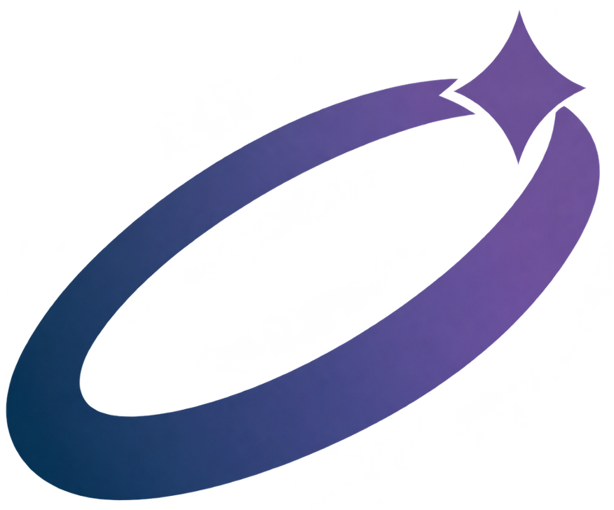

#  AsterMind

[English](README.md) · 简体中文

**面向低轨卫星星座的大语言模型端到端推理服务仿真器**

AsterMind 模拟低轨卫星如何为地面用户提供大语言模型推理服务。它在同一条时间线上推进网关接入、模型推理和 Token 回传，并计入卫星运动、链路可用性变化和带宽竞争。

[技术报告](#技术报告) · [主要特点](#主要特点) · [系统架构](#系统架构) · [构建与安装](#构建与安装) · [快速上手](#快速上手) · [参与贡献](#参与贡献) · [联系方式](#联系方式)

## 技术报告

**AsterMind 技术报告**（公开版 PDF 链接待补充）

## 主要特点

- **仿真范围。** L2 模拟单个多星 Cell 内的 LLM 推理。L3 模拟星座级端到端 LLM 服务，涵盖网关接入、模型推理和响应回传。
- **仿真模式。** Detail Mode 按算子做精细化仿真，Fast Mode 按批次对算子组估时。L2 支持两种模式，L3 仅支持 Fast Mode。
- **模型部署。** 配置张量、流水线和专家并行，并将 Rank 映射到 GPU 和卫星。
- **网络与指标。** 模拟链路变化、路由和带宽共享，查看 TTFT、TPOT 和端到端时延。

## 系统架构


## 构建与安装

**运行前提。** x86-64 Linux，glibc 版本至少为 2.39（例如 Ubuntu 24.04），并提供 Git、C/C++ 工具链和 `libnuma.so.1`。虚拟环境使用 Python 3.12。环境脚本会按需下载 Python 3.12 或 Node.js（含 npm），下载工具时使用 `curl`。样例在 CPU 上运行，无需模型权重或 GPU。

```bash
git clone --branch version/AsterMind-V1.0 https://github.com/GUANYU-Tech/OrbitServe.git AsterMind
cd AsterMind

bash scripts/install-ubuntu-deps.sh
bash scripts/create-venv.sh
source .venv/bin/activate
```

安装 Python 依赖并构建 AsterMind。

```bash
python -m pip install -r requirements.txt
bash scripts/build.sh
```

## 快速上手

### 目录结构

```text
astermind/builder/                场景配置、轨道与物理网络数据
astermind/engine/compute/         模型执行与推理服务
astermind/engine/comm/            集合通信与数据传输仿真
viz/                             L2 和 L3 仿真的本地前端
```

### 启动前端

启动本地服务。三维预览需要支持 WebGL 2 的浏览器。

```bash
bash scripts/run.sh
```

打开[首页](http://localhost:8766/)。

| 仿真范围 | 前端入口 | 样例 |
| --- | --- | --- |
| **L2 · 单编队** | [计算 Cell 仿真](http://localhost:8766/cell/) | [DeepSeek-V4-Pro 网页样例](#l2--deepseek-v4-pro-仿真样例)。 |
| **L3 · 星座级** | [完整场景仿真](http://localhost:8766/workspace) | 样例待补充。 |

### L2 · DeepSeek-V4-Pro 仿真样例

本例在 **Detail Mode** 下用 **TP8 × PP4** 模拟 **DeepSeek-V4-Pro**，四颗卫星各配八张模拟 H200 GPU。

1. 打开[计算 Cell 仿真](http://localhost:8766/cell/)，点击「新建任务」。
2. 在「星座资源」选择 **NVIDIA H200**，设置 **4 颗卫星、每星 8 张 GPU**。静态编队选环形，间距设为 **1 km**。
3. 在「通信网络」中，每星使用 **一组 8 卡 SU**，星间链路选「默认模式」，带宽设为 **400 Gbps**。
4. 在「模型负载」选择 **deepseek-v4-pro** 和 **Detail Mode**。设置两条合成请求，到达率为 **16 请求/秒**，每条 **16 个输入 Token、2 个输出 Token**。
5. 在「并行部署」保持「同池部署」，选择「手动配置」，设置 **TP 8、PP 4、DP 1**，关闭 EP。确认每个流水线阶段映射到一颗独立卫星。
6. 在「调度运行」将「模型长度上限」设为 **1152 Token**，关闭「分块 Prefill」，然后点击「发布任务」。在「仿真结果」查看两条请求及其计算和通信时间线。

### L3 · 完整场景仿真样例

示范数据和运行步骤待补充。

## 参与贡献

欢迎反馈问题、提交修复和贡献可运行的场景。提交 Issue 时请附上 AsterMind 的提交版本、场景配置或最小输入、运行命令、预期结果和实际结果。发起 Pull Request 时请说明改动，并附上运行过的验证。

## 联系方式

- 维护者 1（姓名待补充，邮箱待补充）
- 维护者 2（姓名待补充，邮箱待补充）
