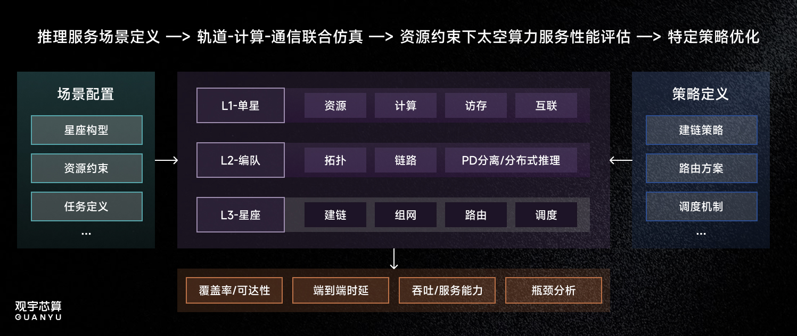

<p align="center">
  <picture>
    <source media="(prefers-color-scheme: dark)" srcset="assets/astermind-readme-lockup-dark.png">
    
  </picture>
</p>

<p align="center">
  <a href="doc/AsterMind-V1-Tech-Report.pdf"><strong>Technical Report</strong></a> · <a href="https://guanyu-tech.github.io/AsterMind/"><strong>Project Homepage</strong></a>
</p>

<p align="center">
  <a href="README.md" lang="en">English</a> · 简体中文
</p>

<h1 align="center">AsterMind V1: Exploring Space Intelligence</h1>

AsterMind 是一个可扩展的星座级太空智算系统仿真平台，为在轨大语言模型服务提供从单星、算力编队到完整星座的系统级评估工具。平台联合建模轨道运动、通信和计算，模拟地面请求接入、卫星转发、排队执行和结果回传的全过程。

开发者可以配置业务负载和星座场景，在星载环境约束下比较不同的建链、路由、任务调度和模型部署策略，评估端到端性能并定位影响服务表现的关键因素。

<p align="center">
  <picture>
    <source media="(prefers-color-scheme: dark)" srcset="assets/astermind-overview-zh.png">
    
  </picture>
</p>

## 核心特性

- **覆盖不同尺度的全链路仿真。** 支持单星、算力编队和完整星座场景，评估各尺度下的设计与优化方案。
- **轨道、通信与计算联合仿真。** 在同一仿真过程中跟踪卫星位置、可见窗口、建链和路由，并模拟传输时延、带宽竞争、计算排队和模型执行。
- **可配置、可扩展的开放验证。** 支持配置星座构型、硬件资源、链路参数、模型部署和业务负载，并在建链、路由、请求调度和状态迁移等环节扩展自定义策略。

## 系统架构


**离线星座构建器**按时间间隔计算卫星位置和星地、星间链路条件，生成包含链路容量与传播时延的拓扑快照，供运行时查询可接入卫星和转发路径。

**状态耦合运行时引擎**按到达时间和接入网关回放请求，选择目标计算单元与转发路径，按需模拟 KV 缓存迁移。数据到齐后，请求排队组批。每批完成后，引擎更新请求进度和 KV 缓存状态，并模拟结果回传至地面网关。

## 构建与安装

### Windows（64位）

[下载 AsterMind v1.0 Windows x64 安装包](https://github.com/GUANYU-Tech/AsterMind/releases/download/v1.0.0-preview.9/AsterMind-v1.0-Windows-x64-Setup.exe)。

### macOS（Apple 芯片）

Apple 芯片版安装包准备中，目标支持 macOS 13 或更高版本。

### Linux 源码安装

**环境依赖：** x86-64 Linux，glibc 版本至少为 2.39，并提供 Git、C/C++ 工具链和 `libnuma.so.1`。需要 Python 3.12。
```bash
git clone https://github.com/GUANYU-Tech/AsterMind.git
cd AsterMind

bash scripts/install-ubuntu-deps.sh
python3.12 -m venv .venv
source .venv/bin/activate
```

安装 Python 依赖并构建 AsterMind。构建前端需要 Node.js 和 npm。

```bash
python -m pip install -r requirements.txt
bash scripts/build.sh
```

## 快速上手

### 打开 AsterMind 前端

启动本地服务。

```bash
bash scripts/run.sh
```

打开本地仿真前端界面 [http://localhost:8766/](http://localhost:8766/)。

<p align="center">
  <picture>
    <source media="(prefers-color-scheme: dark)" srcset="assets/astermind-frontend-cn.jpg">
    
  </picture>
</p>
<h1 align="center"></h1>


### 计算编队仿真

本例在 **Detail Mode** 下，采用 **TP8 × PP4** 并行配制模拟 **DeepSeek-V4-Pro** 的分布式推理过程，仿真场景中的四颗卫星各配八张 NVIDIA H200 GPU。

1. 进入「算力编队仿真」界面，点击「新建任务」。
2. 在「星座资源」选择 **NVIDIA H200**，设置 **4 颗卫星、每星 8 张 GPU**。静态编队选环形，间距设为 **1 km**。
3. 在「通信网络」中，每星使用 **一组 8 卡 SU**，星间链路选「默认模式」，带宽设为 **400 Gbps**。
4. 在「模型负载」中选择 **Deepseek-V4-Pro** 和 **Detail Mode**。设置 **2 条合成请求**，将「到达分布」设为 `constant`，到达率设为 **16 请求/秒**，每条请求的输入长度设为 **20 Token**，输出长度设为 **2 Token**。
5. 在「并行部署」中选择「同池部署」，设置 **TP 8、PP 4、DP 1**，关闭 **EP**。点击「重新生成卡映射」，将四个流水线阶段分别映射到四颗卫星。
6. 在「调度运行」中将「每批请求上限」设为 **16**，关闭「分块 Prefill」，然后点击「发布任务」。在「仿真结果」中查看两条请求及其计算和通信时间线。

### 星座级仿真

本例使用 **Fast Mode** 在星座尺度上模拟**全球推理服务**。仿真场景回放 **300 秒的全球请求轨迹**，共 **168 条请求**，由亚洲、非洲、欧洲和北美的 **5 个地面网关**接入。物理场景配置为 **6,000 颗通信卫星**和 **10 个计算编队**（共 **40 颗计算卫星**）。每个编队均采用 **TP8 × PP4** 部署 **GLM-5.2**。仿真时长为 **360 秒**，拓扑每 **60 秒**更新一次，最后60s留给已到达的请求继续执行。

#### 物理场景

1. 进入「完整场景仿真」界面，点击「新建任务」。在「实验配置」中点「新建物理模型」。
2. 在「物理场景」中，自定模型名称，实验开始时间（UTC）填 `2026-11-20T00:00:00Z`，实验时长填 **360 s**，几何时间片间隔填 **60 s**。「物理模型来源」用于加载此前配置好的物理场景，配置新场景时不需选择。
3. 在「通信星座」中，用卡片右上角上的「−」移除不用的默认星座，点「添加通信星座 → 从参数生成」，选「Walker 参数」。
   - 轨道高度填 **550 km**，设置 **60 个轨道面、每面 100 颗卫星**，倾角填 **53°**，相位填 **1**、初始 RAAN 和初始纬度幅角均填 **0**。
   - 添加后将「星间拓扑预设」设为 **Grid / 4 邻接**。
   - 将「通信卫星硬件预设」设为「自定义硬件」，在「高级硬件参数（手动设置）」填 **6 个 ISL 终端**，地面关联总上限填 **1**。
   - 上划页面回到顶部，点击高亮「通信星座」旁的「计算星座与编队」。
4. 在「计算星座与编队」选 **Fast Mode**，用「计算星座」卡片右上角上的「−」移除不用的默认星座，点「添加计算星座」，自定星座ID，cell数量填 **10**，点击添加星座。
5. 在计算星座的 「算力编队」卡片中，任选1个 Cell 点击「编辑编队」。
   - 在「星座资源」配 物理资源填写**H200 每星8张**，星座几何依次为**4颗卫星、环形、编队距离 1 km、轨道高度 800 km**。点击进入「通信网络」。
   - 在「通信网络」中保持默认配置，每星Scale-Up（SU）分组卡数为8。点击进入「模型负载」。
   - 在「模型负载」选 **GLM-5.2**，在「Roofline 参数配置」填算力效率 **70%**、HBM 带宽效率 **96%**。
   - 在「并行部署」选「同池部署」，并行策略配置 **TP8 x PP4**，关闭 EP，DP1。进入「调度运行」。
   - 在「调度运行」填每批 **请求上限32**，开启「分块 Prefill」，「Prefill 分块上限」填 **0** 保持默认，由每批剩余的 Token 预算决定分块大小。
   - 在「KV 缓存（高级）」**开启前缀缓存** 。
   - 配好一个 Cell 后，点「设为模板并应用到全部 10 个 Cell」，退回到外部界面。
6. 下拉到底部，点击展开「星座轨道与接入参数」
  -「轨道来源」选**晨昏太阳同步轨道**，「cell 对外出口模式」选**单星出口，指定一个成员**，「成员编号」填 **0**，「对外 ISL 终端数」填 **2**。
   - 其他未提及配置均保持默认。
   - 上划页面回到顶部，点击高亮「计算星座与编队」旁的「地面站」。

7. 在「地面站与接入」，先用卡片右上角上的「−」移除默认地面站，再展开「批量导入地面站（CSV）」。
   - 上传[示例网关 CSV](examples/L3_Quick_Start/gateways-quick-start.csv)，点「追加到当前场景」，确认共有 **5 个网关**（广州、新德里、约翰内斯堡、法兰克福、洛杉矶）。经纬度、最低仰角 **25°** 和每站 **16 个终端**，由 CSV 带入。地面节点用途选择 **RF网关回传**
   - 其余配置均保持默认
   - 上划页面回到顶部，点击高亮「地面站」旁的「连接与链路预算」。
8. 在「连接与链路预算」关闭 Cell 间直连，「星间链路计算模型」选**固定带宽**，按下表填写链路参数。「链路带宽竞争（Fast Mode）」中各类有效可用带宽比例可自行设置，默认100% 。填完后点「生成数据并继续」，物理模型生成后自动跳转到「配置实验场景」。
   | 链路 | 每方向上限（bps） | 最大距离（km） | 建链时间（s） |
   | --- | ---: | ---: | ---: |
   | 通信星间 | `400000000000` | 4000 | 2 |
   | 计算—通信 | `400000000000` | 4000 | 2 |
   | Cell 内部 | `1000000000000` | 10 | 2 |
   | 星地通用预算 | `1000000000` | 2500 | 2 |


#### 业务与运行

1. 在「配置实验场景」自定场景名称，「物理拓扑数据」下拉选择刚生成的物理场景。在「路由与调度」将「网络路由」设为**最短累计传播距离**，「Cell 选择策略」设为**最近距离**。在「物理场景中的算力编队」确认共有 **10 个 Cell**。
2. 下拉到底部，在「业务请求」点「批量导入」，选择[示例_300 秒请求](examples/L3_Quick_Start/wildchat-1x-quick-start-300s.jsonl)，格式选 **JSONL**。「应用方式」选「替换当前请求」。点「检查并预览」，确认有 **168 条请求**，再点「应用请求」，其他均保持默认配置。
3. 点击「开始实验并查看结果」

#### 运行与回放

1. 运行结束后，在「请求性能」查看目标 Cell、完成状态、网关侧 TTFT、TPOT 和端到端时延。在「场景回放」点「播放回放」或逐步查看已记录的事件；在三维场景中查看请求的上传和返回路径。
2. 可在左侧菜单栏「运行记录」查看历史实验。

## 贡献指南

欢迎为 AsterMind 作出贡献。提交 PR 前，请阅读 [贡献指南](CONTRIBUTING.md)，感谢所有为项目作出贡献的开发者。


## 致谢

感谢清华大学及无问芯穹研发团队的开源仿真工具[Uni3Sim](https://github.com/thu-nics/uni3sim)。AsterMind V1.0的计算仿真模块和卡间互联通信仿真模块参考了Uni3Sim的仿真方法。

## 联系方式

- **郭立栋** : [guolidong@guanyu.cn](mailto:guolidong@guanyu.cn)
- **朱振华** : [zhuzhenhua@mail.tsinghua.edu.cn](mailto:zhuzhenhua@mail.tsinghua.edu.cn)
