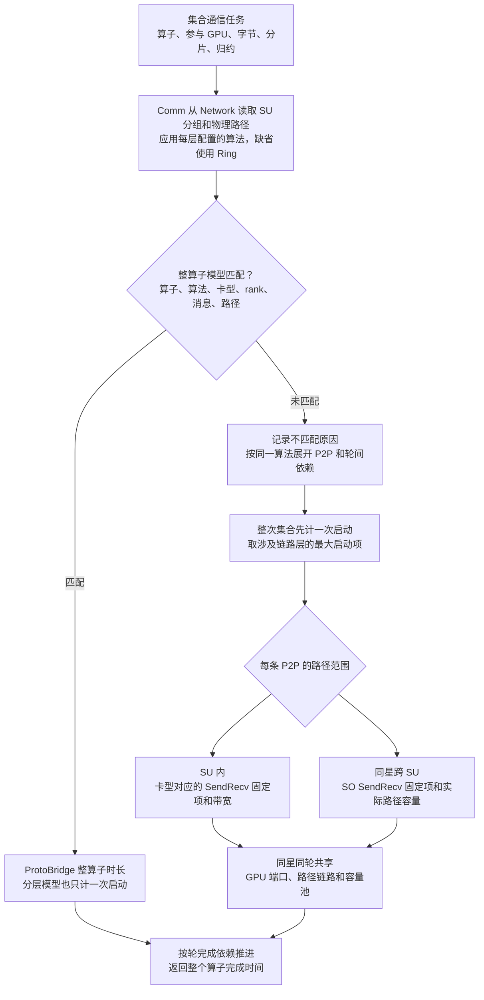

# 星内 Comm 集合通信模型与离线配置

星内 Comm 使用 Uni3Sim 已固定的 ProtoBridge profile 注册表和厂商规则，调用该注册表固定的 ProtoBridge `408d470` Python 公式。ArchPrism 提供算子、GPU 参与者、分片字节和归约方式。本文的两层配置适用于星内任务，包括 SU 内和同星跨 SU。跨星任务和系统传输沿用基线模型。



## 离线输入

| 输入 | 作用 |
|---|---|
| `physical.intra_hierarchies.<satellite>.su_groups` | 每个 SU 的 GPU ID。rank 数来自本次算子的参与 GPU 数。省略分组时，一颗星为一个 SU |
| `physical.links` 或 `physical.templates` | 必须提供多卡通信使用的物理图，包括 SU 内连接和所需的 SU 间连接。每条物理链路有自己的容量和传播时延 |
| `communication.default_hardware_id`、`cell_policies.<cell>.hardware_id`、`gpu_hardware` | 星内通信 profile 的卡型号。优先级为 GPU 映射、Cell 设置、全局默认，默认 H200 |
| `communication.gpu_port_gbps` | 按 GPU ID 覆盖单向端口总容量，发送和接收各计一个容量。默认取卡型的标称单向带宽 |
| `communication.cell_policies.<cell>.algorithms.<scope>.<operation>` | 可选。用 `single_su` 配 SU 内、`intra_cross_su` 配同星 SU 间，每层可独立省略 |
| `communication.intra_profile` 或 `intra_profile_file` | 覆盖 SU 或 SO 的有效调度带宽上限、启动、每阶段固定项和报文效率。使用文件时提供绝对路径或相对于运行目录的路径 |

例如在一颗卫星上配置两个八卡 SU，`su_groups` 中分别列这两组 GPU ID，再在物理配置中连通需要传输的设备。域内可以明确声明 GPU 直连，省略 `su_switches`。Comm 没有单独的 NVSwitch 模式或交换机总容量准入条件。已有物理图里的交换设备仍是 Network 的节点，旧的 Network 路由逻辑仍可参考它。想用无交换机的场景，直接在物理配置里建 GPU 链路。

Ring 和 Tree 指定 rank 之间的发送顺序。对 AllReduce、AllGather(V) 和 ReduceScatter(V)，SU 内、SU 间各自使用显式配置或 Ring 默认值。Comm 按该算法在当前图上查路径。Ring 优先使用 SU 组内声明的顺序，纯邻接环也可以沿实际环重排；Tree 沿可用的双向路径建生成树；FullMesh 展开为所有 peer 对的传输。缺少该算法所需路径时报告对应层和路径错误。AllToAll 和 Broadcast 的默认值分别为 Pairwise 和 Direct。

同星跨 SU 的 AllGather(V) 分为域内、域间两阶段。ReduceScatter(V) 也有域内、域间两个阶段。AllReduce 保留域内 ReduceScatter、域间 ReduceScatter、域间 AllGather、域内 AllGather 四阶段。SU 间按各组内的 GPU 位置对应查路，分片字节跟随原始 rank 顺序。交换网络可为参与 GPU 提供跨 SU 路径。`comm_plan.stages` 记录各阶段的范围、算法、配置来源和轮数。单 SU 匹配整算子 profile 时可以直接估时，否则用对应算法展开。

```json
{
  "communication": {
    "default_hardware_id": "nvidia_h200",
    "cell_policies": {
      "cellA": {
        "hardware_id": "nvidia_a800",
        "algorithms": {
          "single_su": {"all_reduce": "tree"},
          "intra_cross_su": {"all_reduce": "ring"}
        }
      }
    },
    "intra_profile": {
      "so": {"overrides": {"wire_efficiency": 0.95}}
    }
  }
}
```

## 星内两层时序参数

下面三个数依次为 **LL／LL128／Simple**，单位 µs。展开时子流的大小选档，`<64 KiB` 为 LL，`64 KiB–4 MiB` 为 LL128，更大为 Simple。命中整算子时按厂商规则选档。独立 SendRecv 按真实 payload 计一次完整启动。展开集合用整算子的消息大小选启动档，AllGatherV 用最大源分片，各层候选启动时间取最大值，只在首轮前记一次。P2P 逐轮保留固定和数据项。对同星传输，固定延迟取参考阶段值与路径传播时延的较大值，防止双算传播。

| 层 | 参数来源 | 一次启动 | 每步固定项 |
|---|---|---:|---:|
| SU 内 A800 NVLink | Uni3Sim 参考 | 10.383／25.738／23.859 | 2.590／0.659／6.321 |
| SU 内 H200 NVLink | Uni3Sim 参考 | 0.440／11.350／7.944 | 2.590／0.659／6.321 |
| SU 内 C500 MetaXLink | Uni3Sim 参考 | 6.392／10.520／10.000 | 0.500／0.500／0.500 |
| SU 内 910B HCCS | Uni3Sim 参考 | 60／60／60 | 0.200／0.200／0.200 |
| 同星跨 SU，H200 | 400GbE RoCEv2 参考 | 40／40／40 | 1／1／1 |
| 同星跨 SU，其他 GPU | 沿用 H200 RoCEv2 占位，trace 标记 | 40／40／40 | 1／1／1 |

- **SU 内带宽**默认取路径容量与两端 GPU 单向端口容量的最小值。卡型标称单向总容量参考值为 A800 200、H200 450、C500 192、910B 196 GB/s。独立校准的协议档仍可按对应实测值限速，报文效率和信用窗口照常生效。C500 Tree 的参考固定项是每树阶段 1.1 µs。H200 每阶段固定项沿用 A800，H200 的启动项由双卡 Ring AllReduce 实测拟合。C500 的 Simple 和 910B 的启动值仍为参考占位。
- **同星跨 SU 带宽**也使用实际路径和端口容量，RoCEv2 报文效率保留 0.95。提供有效调度带宽上限时取它和物理上限的较小值，若该值已经扣过报文开销，可把效率设为 1。
- **同星展开的同轮竞争**按单向 GPU 端口、路径链路及容量池汇总本轮线上字节，流同时提交，各共享资源的一份容量用于处理其全部流量。每轮等到所有流完成才释放下一轮。这是同一集合算子内部的流级估时，范围为同一轮的同星流。

星内任务的 SU 内和同星 SU 间阶段使用实际路径容量，报文效率代表具体协议开销。

## 直接模型与追踪

- 普通整算子复用 Uni3Sim 注册的 AllReduce／AllGather，厂商规则使用该注册表的 BF16 参考条件。Comm 校验是否同一个 SU、GPU 型号是否一致、算法是否和规则匹配、所需路径是否均匀以及分片是否受支持。
- 未命中会在 `comm_plan.whole_rejection` 留原因，`comm_plan.algorithm` 记录实际算法。星内集合通信展开时，`collective_startup` 记录整次启动，对应流的启动字段为 0。
- 仍可为明确选择的本地任务使用 `IntraSatelliteRoofline` 自带的架构估时，以便对照。混合 NVLink/RoCE 与 ISL 要按路径估时。
