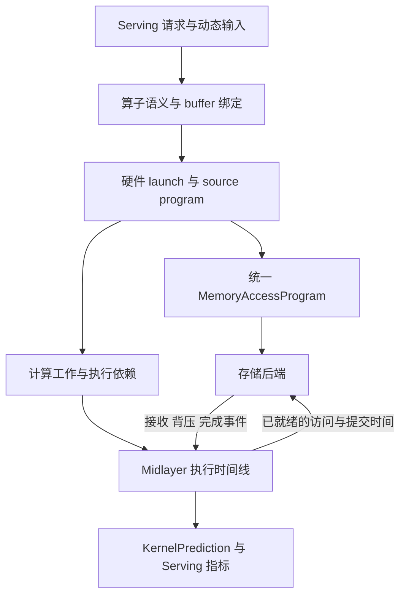

# 统一数据访问描述与存储仿真器对接方案

本方案用于将 Midlayer 生成的数据访问工作交给外部存储仿真器。建议在现有 `src/kernel` owner 内建立统一的 `MemoryAccessProgram`：各算子按同一契约描述访问对象、访问区域与执行依赖；存储后端根据自身能力计算层级流量和完成事件；Midlayer 继续负责计算、launch、任务调度和 Serving 时间线。op、kernel、tile 共用一种表示，通过粒度与语义字段说明精度。

本文第 1–14 节保留统一接口的设计边界与后续路线；第 15 节说明当前生产实现、可运行命令和明确限制。当前包含唯一 typed contract 与 JSONL codec、source-owned 访问生成、backend/session 事件校验，以及 traced Serving 的实际调用绑定。当前报告入口和旧诊断命令迁移范围见 [访存导出说明](memory_interface_readme.md)。外部 adapter 和计算与存储联合求解仍须独立验收，不能从一次 logical 导出推定可运行。实现留在现有 `src/kernel` owner，不改 canonical dataset，不新增顶层 owner。

## 1 双方职责与交接位置



| 工作 | Midlayer | 存储仿真器 |
|---|---|---|
| 算子需要访问哪些数据 | 负责，包括 dtype、布局、有效区和动态索引 | 消费描述 |
| tile、split、worker 与源码可证明的发射规则 | 负责，由现有 launch package 与 predictor 推导 | 消费描述 |
| load/store、DMA 等访问入口 | 声明真实入口和已知策略 | 在约定入口以下模拟 |
| cache、事务拆分、请求合并、替换、回写 | 接管范围内交由后端 | 负责 |
| 存储队列、带宽、延迟与仲裁 | 接管范围内交由后端 | 负责 |
| 计算耗时、计算资源竞争、barrier、任务就绪 | 负责 | 提供影响这些依赖的存储事件 |
| 跨 kernel 数据身份与生命周期 | Serving 产生绑定并推进生命周期 | 保留相应存储状态 |
| 指标与限制 | 汇总两端结果 | 报告自己的覆盖、假设与限制 |

交接位置必须在后端接管范围的入口之前。接管 L2 与 DRAM 时，应提交到达 L2 之前、尚未经过 L2 命中判定的请求；接管完整设备存储层级时，应提交源码发出的访问；只接管 DRAM 时，上游 cache 模型仍需先产生 DRAM 请求。仅有 op 级逻辑访问的后端可以计算相应抽象层的结果，但不能据此声称完成了源码请求或物理事务级仿真。

每个物理资源和请求变换只能有一个计价 owner。联合仿真不能同时保留 Midlayer 的 DRAM 时间并叠加外部 DRAM 时间，也不能先用内部 LRU 算 miss、再把结果作为原始访问交给另一套 L2。

## 2 现有代码与需要补齐的边界

| 现有位置 | 已有能力 | 对接所需变化 |
|---|---|---|
| [`model_contract.py`](../src/kernel/model_contract.py) 的 `MemoryPathDemand`、`MemoryNodeDemand` | 统一读写路径与各层 bytes、transactions、并发和队列需求 | 增加访问对象与区域契约；原结构保留为解析后端的需求投影 |
| [`predictors/common.py`](../src/kernel/predictors/common.py) 的 `PredictionInput.memory_paths` | 将 kernel 资源需求交给统一公式 | 在外部模式中引用未计时的访问与后端结果，不能先生成被接管层级的经验流量 |
| [`predictors/gemm.py`](../src/kernel/predictors/gemm.py)、[`predictors/fused_moe.py`](../src/kernel/predictors/fused_moe.py) 等 | 各自推导访问行为，部分已使用统一 miss core | 将访问生成与 cache 求解分开，使同一访问程序可交给选定后端 |
| [`cache_traffic_sim.py`](../src/kernel/cache_traffic_sim.py)、[`cann_gemm_schedule.py`](../src/kernel/launch_config/cann_gemm_schedule.py) | 部分路径有对象 key、访问大小、读写状态或源码顺序 | 将局部对象表示映射成统一对象与访问；对象 key 不能直接冒充物理地址 |
| [`formula.py`](../src/kernel/formula.py)、[`memory_path_solver.py`](../src/kernel/memory_path_solver.py) | 统一解析存储时间与资源下界 | 在明确边界处选择后端，避免保留重复的 path、typed service 或 latency 计价 |
| [`model_contract.py`](../src/kernel/model_contract.py) 的 `PipelineStageDemand`，[`pipeline_model.py`](../src/kernel/pipeline_model.py) | 描述计算与存储阶段、有限 buffer 和依赖；部分需求会解析成带 duration 的阶段 | 外部模式下存储阶段等待对应完成事件，而不是使用预先解析出的存储 duration |
| [`kernel_plan.py`](../src/serving/kernel_lowering/kernel_plan.py) 的 `KernelCall` | 有 call、rank、source node 和跨调用依赖 | 绑定跨调用共享的 allocation、view 与动态访问输入 |
| [`kernel_predict.py`](../src/serving/kernel_lowering/kernel_predict.py) 的 `KernelPredictionMemo` | 复用相同契约的预测结果 | 有状态后端仅复用访问模板与静态计算工作，不能仅凭相同 shape 复用完成时间 |

现有 `resource_input()` 可以提供解析资源需求，但它不是完整的外部访问生成入口；部分路径在生成资源需求时已经调用 cache 求解，部分 transfer predictor 也不提供该接口。迁移按实际支持域进行，不能将已有统一类型等同于所有 kernel 已有完整 trace。

## 3 统一契约的组成

统一表示由 `MemoryAccessProgram`、`MemoryAllocation`、`TensorView`、`AccessScope`、`MemoryAccess` 和程序结构组成。内存中的 typed contract 与导出文件使用同一字段定义；序列化、校验和版本迁移由 `src/kernel` 的唯一实现负责，不另建一套手写 wire schema。

| 对象 | 必要内容 | 用途 |
|---|---|---|
| `MemoryAccessProgram` | 契约版本、program ID、hardware ID、scope、对象声明、访问程序、覆盖与限制 | 一次可验证的访问交付单元 |
| `MemoryAllocation` | allocation ID、设备与存储域、字节大小、生命周期、地址绑定 | 识别同一块存储，表达真实别名与跨调用复用 |
| `TensorView` | view ID、allocation ID、byte offset、shape、dtype、物理布局 | 解释 tensor 与 storage 的关系 |
| `AccessScope` | scope ID、op IDs、kernel call ID、tile 坐标、rank、stream、agent | 说明访问属于哪项工作，支持融合与拆分 |
| `MemoryAccess` | access ID、scope、allocation/view、读写、区域、入口、语义、策略、依赖 | 双方交换的基本访问单元 |
| 程序结构 | 顺序、并发组、受限循环、条件与事件引用 | 在保留语义的前提下压缩访问集合与执行关系 |
| 覆盖声明 | 访问语义、区域与顺序的已知程度、支持状态、未覆盖项目 | 决定后端可接收的能力域 |

字段在 owner 边界完整校验。Optional 字段由类型定义，输入规范化为显式 `null` 或空序列；不能以缺 key、默认 tile、默认地址、默认命中率或未知顺序的隐式补全制造可运行结果。所有枚举和 region 类型必须穷举分派。

### 3.1 粒度与语义分别声明

| 字段 | 值 | 含义 |
|---|---|---|
| `granularity` | `op`、`kernel`、`tile` | 当前访问描述对应的工作范围 |
| `semantics` | `logical` | 算法或 ABI 要求的访问，未保证复现执行程序的重读、padding 和指令请求 |
| `semantics` | `issued` | 源码或静态程序可证明的实际访问，包含重复读取、有效 padding 与真实 workspace |
| `semantics` | `transaction` | 某个明确入口的事务，已有可靠的地址与事务几何 |
| `ordering` | `partial_order`、`total_order`、`unordered` | 已知的依赖或顺序程度 |

kernel 粒度也可以携带完整的 issued 循环程序；tile 粒度也可能只有 logical 区域。粒度本身不证明访问精度。op 到 kernel、kernel 到 tile 的细化必须使用合法的 launch 与 source 语义，不能按字节比例平均分配或猜测访问顺序。

op、kernel、tile 描述可以用于同一工作的不同视图，执行时只选其中一个覆盖同一访问集合的表示。粗粒度摘要是细粒度访问的汇总，不能重新提交执行。一个 fused kernel 的 `op_ids` 可以对应多个算子，一个算子也可对应 main、reducer 等多个 kernel，不能假设一一对应。

### 3.2 数据对象与地址

`allocation_id` 在 session 内唯一；同一块 buffer 被多个 kernel 读取时使用相同 ID。`view_id` 可以不同，但共享 allocation 的 view 必须保留真实 byte offset。权重、激活、KV、partial、scale、索引和 workspace 均作为普通对象表达，存储后端不需要理解 kernel 名称。

Tensor 的 shape、dtype 与 storage 大小分别声明。连续布局可由 shape、元素大小和 byte stride 完整表达；packed 量化、swizzle 或分块布局使用有类型的布局映射，并把 scale 等辅助对象显式列出。`numel × dtype_bytes` 不能代替未知的 packed storage。首版可只支持连续和非负 stride 的布局，其余明确为 unsupported。

普通 cache、带宽与 DRAM 仿真只需要对象与地址信息，不要求传输完整权重或激活值。决定访问地址的索引、page table 与路由信息是必要的正常动态输入；如果后端模拟压缩、值相关访问或原子操作，则额外要求相应内容语义与能力，第一版不将这些能力隐含在 dtype 中。

地址绑定分为三个能力等级：

| 等级 | 交付信息 | 可支持的结论 |
|---|---|---|
| `object` | allocation ID、大小、相对 offset、重叠关系 | 对象或容量级模型；不能推断 cache set、bank 或 channel |
| `virtual` | 虚拟基址与明确的页映射能力声明 | 虚拟地址行为；无物理映射时不能推断物理分区 |
| `physical` | 物理基址或 page segments、设备域与映射契约 | 对应映射下的地址与分区级模拟 |

独立 kernel 示例可以绑定明确标记的合成模拟地址；这些地址来自实验设置，不是 production 地址真值。对地址对齐、allocation placement 和 page mapping 的假设必须进入结果。不能把局部 LRU 的对象编号乘以对象大小就声称恢复了物理地址。

allocate、输入初始化、free、对象迁移由调用者显式声明。free 不等于 cache flush；新 allocation 复用同一物理地址时，后端仍按地址与一致性规则处理。计算阶段产生 buffer 的可见内容，需通过相应 producer 完成或内存可见事件发布；不能仅因对象已声明就允许读未初始化区域。

### 3.3 访问区域

| `region.kind` | 内容 | 适用场景 |
|---|---|---|
| `span` | byte offset、byte length | 连续读写 |
| `strided` | base offset、各维 count、byte stride、每个元素的 byte span | tensor 切片、非连续行和 tile |
| `segments` | 一组明确的 span | 不连续页、已解析的 scatter/gather |
| `indexed` | 索引来源、目标布局、索引值或动态解析依赖 | MoE token 路由、KV page table、间接访问 |

`strided` 的空间集合按 `offset = base + Σ(index[d] × stride[d])` 定义。访问字节总量统计每次访问，unique footprint 统计地址区间并集；二者不混用。零 stride 或重复 segment 可以表示重复访问，不能在未声明等价性的情况下去重。mask 必须规范化为实际访问的有效区域；分配过的 padding、尾 tile 和实际被读写的 padding 分别记录。

交付给后端的 region 一律使用 allocation 内的 byte offset。builder 先应用 TensorView 的 offset 与布局映射，再形成 region；后端不能再次叠加 view offset。view 保留为可解释元数据，避免同一 slice 在两端重复偏移。

region 描述的空间展开顺序不自动成为硬件时间顺序。并行 lane 的请求必须保留并发属性；若只知道区域，不知道 lane 映射或 coalescing，后端不能将其标为 transaction 级输入。

间接访问必须同时表达索引对象的读取和目标对象的访问。正常 workload 已提供索引值时，可以直接规范化为 segments，并保留索引读取；指针追踪需要等待对应索引读取和计算依赖后才能形成目标请求。只有 expert histogram 或 KV 长度而缺少 token/page identity 时，允许输出逻辑范围或界限，不能伪造精确地址与跨路由共享。

### 3.4 访问字段与程序结构

每个访问至少需要以下字段。`scope` 引用已声明的 scope；`source` 指提交方 agent 与真实访问引擎；`entry` 指双方约定的存储入口。

| 字段 | 内容 |
|---|---|
| `access_id` | program 内唯一，展开循环时通过实例索引形成唯一 ID |
| `scope_id` | 关联 op、kernel、tile、rank 和 agent |
| `allocation_id`、`view_id` | 被访问对象；没有 tensor view 的 byte buffer 使用显式 null |
| `operation` | 首版为 read 或 write；atomic 等扩展在双方支持后定义 |
| `region` | 一种完整校验的访问区域 |
| `semantics` | logical、issued 或 transaction |
| `source`、`entry` | 来源与交接入口，硬件资源名沿用真实 HWSpec/launch contract |
| `request_shape` | 可选的有类型请求组几何，例如 DMA descriptor、vector 宽度或同指令 lane 地址；未知时 null |
| `policy` | 只有源码或 ABI 已知的 bypass、cache allocation、write 等策略；未知项显式 null |
| `dependencies` | 所等待的 access、compute、barrier 或生命周期事件及事件类型 |
| `completion` | 哪种后端事件满足本访问的消费条件 |
| `evidence_refs` | 已有 source/launch/配置依据的引用；不在调用方复制 provenance SHA |

程序结构采用有类型的 `sequence`、`parallel` 和 `repeat`，循环只能使用受限整数范围、常量与仿射索引；不传任意 Python 表达式或依赖 kernel 专属回调。JSON 中的顺序列表只表达明确声明的关系；不能仅因序列化先后就让不同 worker 串行执行。条件执行需要正常动态输入或可复现的源码判据；未知条件使相应能力为 partial/unsupported。

后端需要复现 LD/ST coalescing 时，必须取得合法的 request_shape 与 lane/group 信息，不能按 strided region 的元素枚举顺序拼成一条硬件指令。只接受区域描述的后端可以处理声明的对象或 streaming 抽象，结果保留其事务几何与发射精度限制。

compute 与 barrier 沿用 Midlayer 的已有执行 contract。访问程序引用其事件 ID，不把计算公式复制到存储协议。有限共享 buffer、producer/consumer slot 和复用生命周期也保留在执行图中；slot 的释放条件区分请求被接收、数据可消费和 consumer 完成。

## 4 GEMM 的完整交付示例

示例显式规定 `C = A × B`，A 为 `[64,64]`，B 为 `[64,128]`，C 为 `[64,128]`，均为 BF16 连续行主序，tile 为 `[32,64,32]`。每个输出 tile 在两个 K step 中分别读 A/B panel，结果在片上累加，最后写一次 C。该程序仅用于解释契约，不声称复现某个 vendor GEMM 二进制。

| 对象 | 大小 | shape | byte strides |
|---|---|---|---|
| A | 8192 B | `[64,64]` | `[128,2]` |
| B | 16384 B | `[64,128]` | `[256,2]` |
| C | 16384 B | `[64,128]` | `[256,2]` |

三个 allocation 分别绑定独立对象；三个 view 的 byte offset 均为零。采用 object 地址等级时无需虚构基址。op 级 logical 描述为读 A 全域、读 B 全域、写 C 全域；tile 级描述使用同一事件格式，变化的是 scope、region、重复次数与依赖。

首个输出 tile 的首个 K step 的 A 访问如下，示例中不确定的入口与缓存策略显式保留为 null，因此只能交给接受这种 logical 输入的后端；实际 issued 对接需要 source owner 补齐入口与发射依据。

```json
{
  "access_id": "gemm0.tile0.k0.read_a",
  "scope_id": "gemm0.tile0.k0",
  "allocation_id": "A",
  "view_id": "A_view",
  "operation": "read",
  "region": {
    "kind": "strided",
    "base_offset_bytes": 0,
    "counts": [32, 32],
    "strides_bytes": [128, 2],
    "element_span_bytes": 2
  },
  "semantics": "logical",
  "source": {"agent_id": "tile0", "engine": null},
  "entry": null,
  "request_shape": null,
  "policy": null,
  "dependencies": [
    {"event_id": "A_initialized", "event_kind": "visible"}
  ],
  "completion": "read_ready",
  "evidence_refs": ["example_gemm_program"]
}
```

其余访问使用相同字段。A panel 的 base offset 是 `m0 × 128 + k0 × 2`，B panel 是 `k0 × 256 + n0 × 2`，C tile 是 `m0 × 256 + n0 × 2`。B region 的 counts 是 `[32,64]`、strides 是 `[256,2]`；C region 同样为 `[32,64]`、`[256,2]`。

```text
每个输出 tile (m0, n0)
    K step 0: read A panel 与 read B panel 可并行
              两者 read_ready 后才能执行 compute 0
    K step 1: 按所选流水线提交 A/B 预取
              计算等待数据就绪和累加器依赖
    compute 1 完成后提交 C tile write
    C 的可见完成事件发布给下游 consumer
```

同一 A panel 会被两个 N tile 读取，同一 B panel 会被两个 M tile 读取。后端依据对象、区域与实际时序判断复用；Midlayer 不预先声明第二次一定命中。四个输出 tile、每个两个 K step，共 8 次 A panel 和 8 次 B panel 读取。

| 统计 | 人工可核对的结果 |
|---|---|
| A requested bytes | `8 × 32 × 32 × 2 = 16384 B` |
| B requested bytes | `8 × 32 × 64 × 2 = 32768 B` |
| C written bytes | `4 × 32 × 64 × 2 = 16384 B` |
| 读写请求总字节 | `65536 B` |
| A/B/C unique footprint | `8192 + 16384 + 16384 = 40960 B` |
| L2、DRAM bytes | 由后端按入口、策略、地址与时序得出，不等同于上述任一项 |

该例同时验证不同粒度格式一致、重复读取保留、footprint 与流量分离。尾 tile、split-K、partial dtype、独立 reducer 和 in-place accumulate 都必须由真实 launch/source 增加相应对象与事件，不能套用本例中“只写一次 C”的假设。

## 5 三种对接方式共用同一契约

| 方式 | 输入与输出 | 适用目标 | 能力边界 |
|---|---|---|---|
| 离线导出 | program、对象、依赖与已知时间约束；返回访问统计或模拟结果 | 最先打通格式，让对方独立解析与回放 | 无真实发射时序时只能模拟明确声明的抽象程序或调度假设 |
| 单 kernel 联合求解 | 访问程序与计算计划进入一个隔离 session；返回 kernel 完成时间和诊断 | 验证计算与存储的相互等待、预取和流水线 | 不自动提供跨调用 cache 状态 |
| Serving 有状态联合仿真 | 多个 kernel 的就绪工作增量提交给共享设备 session；返回事件 | 跨 kernel 复用、KV 生命周期与并发竞争 | 要求数据身份、时间协调与实际调度域闭合 |

三种方式改变执行方式，不改变事件字段。外部程序可以先只接受 op/kernel 级 logical 访问，之后接受同格式的 issued tile 程序。不同精度的结果必须携带各自覆盖声明，不将格式兼容等同于性能等价。

推荐首先支持完整设备存储后端模式：在受支持的源码访问入口接入，存储仿真器接手其下游 cache/DRAM。DRAM-only 模式另行明确请求生成 owner；这两种模式不能使用同一字段名掩盖不同的提交入口。

## 6 后端能力与运行接口

### 6.1 能力协商

后端启动时返回 `MemoryBackendCapabilities`，列出支持的契约版本、硬件域、访问语义、粒度、region 类型、地址等级、入口、读写策略、完成事件、有状态执行、时间精度与可用诊断。program 声明所需能力，连接配置声明接管资源。三者匹配后形成不可变的 `MemoryExecutionContract`。

同一 session 的模型边界在运行中不隐式变化。未支持的 indexed region、未知 bypass 策略、缺少物理映射或不支持的完成条件，要么在启动前拒绝，要么作为明确允许的 partial 导出保留；partial 导出不能产生超出能力域的完成时间。配置为外部后端后，失败不得悄悄切回内部解析模型。

一个 request ID 在指定入口只代表一次工作。若后端将其拆分成多个事务，内部子事务仍关联原 request ID；返回的完成事件必须明确是整个请求完成还是允许的局部消费条件，不能把首个子事务返回当成全部数据就绪。

### 6.2 建议的最小接口

以下是职责接口，不是已经实现的 Python API。进程内调用、子进程或 RPC adapter 均可实现相同 contract。

```text
backend.capabilities()
    -> MemoryBackendCapabilities

backend.open(execution_contract, initial_state)
    -> MemorySession

session.declare(allocation, views, lifecycle_events)
    -> 声明校验结果

session.try_submit(request_instance, submit_tick)
    -> accepted(request_id) 或 blocked(next_wakeup)

session.advance(until_tick)
    -> 有序的 MemoryEvent 列表

session.next_event_tick()
    -> 下一已知事件时间，或显式无事件

session.close(close_policy)
    -> 未完成工作状态与 session 诊断
```

`try_submit` 成功后后端拥有该请求；被 blocked 的提交未产生工作，调用方只能在允许的唤醒条件下重试，不能重复扣流量。接收顺序不保证完成顺序。后端必须提供一致的 request ID、时间与结果，即使内部使用不同的 cycle 或事务单位。

### 6.3 返回事件与完成语义

| 事件 | 含义 | 可以解除的等待 |
|---|---|---|
| `accepted` | 请求已进入约定后端 | 仅释放源码明确以接收为条件的 producer、slot 或队列 |
| `read_ready` | 请求规定的数据已可被 consumer 使用 | 计算阶段的数据依赖 |
| `write_visible` | 在约定的一致性域内，后续 consumer 可观察写入 | 对应 RAW 依赖或 barrier |
| `retired` | 请求在后端约定边界内不再占用资源 | 对应队列、credit 或 drain 条件 |
| `wakeup` | blocked source 可重试，或后端需要时间线继续推进 | 提交背压 |

读、写使用什么事件结束 kernel 由 source/ABI 与执行模式决定。store 被接收不一定使下游读取合法；write visible 也不一定已到 DRAM。kernel 结束后可能仍有 writeback 占用后端，这些工作会影响后续 kernel，不能在调用结束时无条件抹除。

可见性域由 execution contract 声明，事件需要关联相应 allocation、区域与域。不同 agent、kernel 或设备的消费条件按实际一致性语义校验；不能用同一条未限定作用域的 write_visible 解除所有 consumer。

`close_policy` 明确选择保留状态、等待规定的 drain 或显式 flush。flush 是独立工作并单独归因，不能为了让窗口内 DRAM 写等于输出 footprint 而自动加入。模拟窗口内 traffic 与最终 drain 后 traffic 分别报告。

### 6.4 时钟与确定性

双方约定整数 tick、tick 对应的秒数、提交时刻和事件时刻语义。后端 cycle 与 Midlayer 时间之间使用明确的转换和舍入规则；结果转为现有 `KernelPrediction` 的秒单位。若设备频率会变，转换 contract 必须说明对应区间，不能用固定频率暗中外推。

全局时钟只能前进。存储后端推进到 T 之前，协调器保证不会再提交时间小于 T 的已就绪请求；多个 agent 在同一 tick 的请求需成组提交或采用双方约定的仲裁，不按导出文件行序串行化。某 kernel 尚未结束时，不能先把后端推进到它未来的完成时间，再补交另一个更早开始的 kernel。

确定性依赖同一 program、binding、backend 配置、initial state 与仲裁规则。后端若采用随机机制，seed 和具体模型必须显式进入执行配置。未掌握的硬件调度可作为已命名的模拟假设，但不能称为 observed 调度。

## 7 计算与存储如何联合推进

联合执行使用同一个任务依赖图。计算阶段包含现有的 typed compute 工作与资源；存储阶段引用 access ID，不预先填入被接管资源的 duration。source 允许的预取可以与计算并行，但受 producer/consumer buffer、请求容量、worker 和 launch 约束限制。

一次推进过程如下：

1. Midlayer 找到依赖已满足、source slot 与 buffer 允许的计算或访问工作。
2. 计算工作在相应计算资源上预约；访问工作在当前 tick 提交给存储后端。
3. 后端接受请求或报告背压；Midlayer 据此保留或释放相应 slot。
4. 协调器选择计算完成、存储事件和其他全局事件中的下一个时刻。
5. 事件满足相应依赖，后续计算、访问、barrier 或跨调用工作变为可就绪。
6. 执行到 source 规定的 kernel 完成条件，产生统一 `KernelPrediction`；尚未 drain 的存储工作继续属于 session。

```text
read A ───┐                     ┌── 下一 tile 的 read
          ├── read_ready ── compute ── write C ── write_visible
read B ───┘          │                               │
                     └── 受 source buffer 限制的预取 ┘
```

“先算完整 kernel 时间，再叠加外部 memory stall”无法正确处理流水线重叠和背压；“总时间取 compute 与 memory 的最大值”也仅适用于有证据的聚合模型。联合模式由依赖与事件推进产生 makespan。首请求延迟、局部 queue lifetime 和重复 buffer 周期使用后端事件，不再额外加内部同一机制的下界。

现有解析模型还承担某些聚合 demand 与 envelope。无法将 envelope 还原为合法访问/计算依赖的组合保留原解析支持域，并将对应外部模式标为 unsupported；不能把一个均分后的 bytes stage 当成完整源码程序。

### 7.1 全层级模式与 DRAM-only 模式

| 模式 | Midlayer 保留的存储模型 | 后端负责 | 请求入口 |
|---|---|---|---|
| 完整设备存储 | 接管范围外的 source/执行约束 | 已协商的 cache、片上路径、DRAM 与队列 | 合法的 issued load/store 或 DMA 描述 |
| L2 与 DRAM | 上游明确保留的 source/L1 行为 | L2、DRAM、对应仲裁与回写 | 上游实际到达 L2 的请求 |
| DRAM-only | cache、coalescing 与上游队列 | 仅 DRAM 与其控制器 | miss 与回写形成的物理 DRAM 请求 |

DMA 的事务生成、LD/ST 的 coalescing、请求 source slot 和 DMA descriptor 容量均在 ownership 表中逐项明确，不能只写“memory 由外部负责”。后端不认识 NPU 内存路径时，不把 MTE、UB、L1、L0 强制翻译成 GPU cache。当前目标接口允许不同硬件使用同一格式，但不保证某一个后端支持全部硬件。

## 8 跨 kernel 与 Serving 状态

Serving 的 buffer 绑定负责将真实跨调用关系连接起来：权重在生命周期内保持 identity，激活的 producer 与 consumer 引用同一 allocation，KV 的请求/page/block identity 来自正常动态输入。仅凭两个相同 shape、同一层名称或相同 KV 长度不能建立物理共享。

每个可共享的物理存储域对应一个 session，覆盖其中的调用与必要的地址空间。不同 rank/device 不因 shape 相同而共享 cache。memory-only 后端不承担 interconnect 或 collective timing；跨设备搬运由现有通信/transfer owner 与明确的传输边界协调，不能遗漏或重复计价。

初始状态必须是显式 cold、由已知预热工作生成的 warm，或可验证的 checkpoint。未知缓存状态只能保留为 unknown 并限制结论。prefix cache 的逻辑命中长度不等于 GPU L2 命中；未知 KV page identity 不能被假定为相同物理页。

有状态 session 中可缓存访问模板、源码展开结果和静态计算参数，不能仅凭 `KernelSpec` 缓存最终 duration。相同 kernel 第二次执行可能命中 cache，也可能遇到尚未完成的写回；顺序不同或并发集不同也会改变结果。若要复用结果，必须有完整、可验证的后端状态等价条件，首版不实现这类复用。

独立调用模式可以在显式重置的同一初始状态下复用结果。Serving 有状态模式首先闭合串行的两个 kernel，再扩展真实重叠；不能把逐项执行的后端 session 宣称为已经模拟了并发竞争。

## 9 生产入口与 owner 迁移

最终预测仍由 `src.kernel.kernel_base.predict(KernelSpec, HWSpec, method)` 返回统一 `KernelPrediction`。计划构建、访问推导、计算工作和结果汇总全部留在 `src`；evaluation 只负责 case、运行设置、观测比较与报告。

建议为统一入口增加 keyword-only 的 `memory_context`，保留现有三个位置参数与默认解析行为。context 包含已协商的后端、对象绑定、initial state 或经过校验的联合执行结果。它是生产执行上下文，不允许调用者传入观测 duration、任意资源时间覆盖或经验修正。

```text
build_memory_access_program(KernelSpec, HWSpec, bindings, granularity)
    -> 同一个 predictor/source owner 生成的未计时访问程序

predict(KernelSpec, HWSpec, method, *, memory_context=None)
    -> 统一 KernelPrediction
```

`build_memory_access_program` 是用于准备和导出访问的生产契约入口，不是另一套时间 predictor。单 kernel 模式可在 `predict` 内构建计划并驱动隔离 session。Serving 联合模式先通过同一组生产 builder 准备各调用工作，由共享协调器推进，最后让统一 `predict` 校验执行结果并汇总每个调用的 `KernelPrediction`；不能先按调用顺序同步算完所有 duration，再构建并发时间线。

联合执行结果必须绑定 call ID、program 实例、地址绑定、backend 配置、时间域和 session，避免把另一条调用的结果误用。该绑定使用结构与可解析引用，不能让每个 caller 重复维护 source SHA。多调用模式的准备、执行和汇总阶段需要显式 API；在这一点实现之前，外部模式只声明隔离单 kernel 支持。

| 文件或现有 owner | 拟议职责 |
|---|---|
| `src/kernel/model_contract.py` | 唯一访问契约、region、能力和结果类型，完整边界校验 |
| `src/kernel/predictors/<family>.py` | 算子访问语义与计算工作，分离访问生成和 cache 求解 |
| `src/kernel/launch_config/<hardware_id>/` | 源码 launch、tile、worker 与离散发射事实，不横向 import |
| `src/kernel/memory_path_solver.py` | 后端接口、协商和既有解析存储求解；具体 adapter 必要时拆到同一 owner 内 |
| `src/kernel/formula.py`、`pipeline_model.py` | 计算与存储事件绑定、资源 owner 和最终时间汇总 |
| `src/kernel/kernel_base.py` | 统一预测与访问生成入口 |
| `src/serving/workload/`、`kernel_lowering/` | allocation/view 绑定、跨调用依赖、session 与全局事件协调 |
| `scripts/export_memory_access.py` | 可选的薄导出 CLI，调用生产 builder 与 codec |
| `evaluation/` | 覆盖、守恒、差异、支持域与性能报告 |
| `tests/kernel/` 与对应 Serving 测试 owner | 契约、fail-closed、物理不变量与少量端到端 smoke |

保留 `MemoryPathDemand` 作为解析后端的数据需求及诊断投影，不再把它当作所有外部后端的原始访问输入。迁移不要求首轮重写全部 predictor：受支持的 family 使用统一程序，其他 family 在外部模式明确 unsupported；默认解析模式继续使用原有合法路径。长期移除双份访问推导，让解析与外部后端消费同一访问生成来源。

## 10 导出格式与运行产物

内存中使用 immutable typed contract，首版离线交付采用 JSON Lines；导出前完成边界校验，写完后包含完整 trailer。记录类型只有 header、allocation、view、scope、program block、受允许的动态索引输入和 trailer。event 使用相同 `MemoryAccess` 表示，通过结构引用或有界展开交付。

header 声明契约版本、硬件、入口边界、地址等级、时间单位、访问语义与 coverage。trailer 包含实际记录数、访问实例数、每对象每方向的 requested bytes，以及可计算时的 unique footprint；无法确定的统计为显式 unknown，不写零。截断文件、记录缺失或 trailer 不一致必须拒绝执行。

所有地址与大小均以 bytes 表达，时间以协商 tick 表达。可能超过跨语言安全整数范围的 64 位地址、计数和 tick，在 wire codec 中使用规范十进制字符串，在内存中恢复成整型；该编码由字段类型决定，不能由每个 adapter 自行猜测。硬件 ID 沿用 `nvidia_a800`、`metax_c500`、`ascend_910b`、`nvidia_h200` 等 canonical 名称。

访问程序使用 sequence/repeat 保持紧凑，后端 adapter 按 chunk 增量展开；除非双方明确要求且规模允许，不把大型 Serving workload 物化成数十亿条逐元素记录。程序压缩必须保持对象重叠、依赖、并发与实例 ID，不能用聚合 bytes 偷换 request program。

可再生成的导出程序、模拟日志和比较报告放在 `experiment_logs/evaluation/` 子树，遵守已有组织约定。输入的 source、launch 与正常动态 workload 引用已有 owner，`src/` 不存数据 payload；本次设计不新增 canonical dataset schema。

## 11 必须成立的校验与结果口径

| 不变量 | 检查方法 |
|---|---|
| 所有对象和事件引用有效 | contract 校验 ID 唯一性、外键、作用域与展开实例引用 |
| region 落在合法 storage 内 | 计算 span/stride/segment 的地址界限，检查整数溢出、view offset 和有效掩码 |
| 别名与复用真实保留 | 同一 allocation 的重叠访问映射同一地址；不同 view 不创建新 storage |
| 重复访问不能被 unique footprint 吞掉 | 按 occurrence 累计 requested bytes，与地址区间并集分别输出 |
| 覆盖视图只执行一次 | 验证同一访问集合只有一个执行表示，op/kernel/tile 摘要不再次提交 |
| 读写依赖与生命周期合法 | 检查初始化、producer 可见事件、free 与 live request，拒绝非法读取和复用 |
| 后端计价 owner 唯一 | 校验 ownership 表，接管资源的内部 path/service 不再参与该执行的计价 |
| 时间因果一致 | 事件 tick 不早于提交与依赖，拒绝时间倒退或回填；背压重试不重复发射 |
| 结果无法跨调用误用 | 校验 program、binding、session、backend 配置与 call ID |
| 缺能力时明确失败 | 未知 region、版本、策略、入口或映射不能落入默认分支 |

结果同时报告 requested bytes、unique footprint、后端各层 traffic/transactions、queue 和 service 状态、访问完成事件、kernel makespan、backend identity、initial state、支持域与 limitation。每个统计说明入口和单位；logical 请求字节不能与 profiler DRAM bytes 直接作同口径比较。

联合模式中的资源 busy time 可能重叠，总和不等于 kernel wall time。阶段等待、后端 service time、排队和关键路径分别表达，避免将一次停顿在多个字段中重复累计。后端未支持某个计数器时保持 null；可以产生合法完成时间而不具备全部计数器，报告不能伪造零流量。

## 12 零拟合与已裁决机制的边界

访问程序的来源仍限于算子与编译器源码静态语义、硬件规格、独立机制微基准和允许的非 duration launch observation。外部后端同样不能使用 production workload duration 回归参数、选择时序、估计相位或添加 residual correction。

已有裁决继续适用，详见 [`decisions.md`](decisions.md)。C500 MoE 的 CTA 进度失锁不会因为更换数据格式就自动解决：如果只提供原锁步访问序列，另一存储后端仍缺真实请求时序；若要重开精度问题，需要满足已有架构授权、硬件来源与发射机制条件。H200 的 workspace footprint 也不能自动成为驻留证明。

后端模拟得到的 duration 属于 Forward 的机制推演结果，不属于观测真值。输入 production duration 或用评估误差选择 cache 参数仍然违规。支持状态、模型来源与真机验证状态分开报告；“已对接并能运行”不能升级成“已验证精度”。

## 13 实施顺序与验收条件

实现按以下交付推进，每阶段都能独立检查。需要 worker 时沿用仓库统一 Goal 模板；以下内容是实施路线，不替代 Goal 的 hard acceptance gates。

| 阶段 | 最小交付 | 验收方式 |
|---|---|---|
| 1 统一格式 | typed contract、codec、logical GEMM 导出；支持 span/strided、对象身份与依赖 | 对第 4 节示例核对 65536 B requested、40960 B unique；往返解码不改变访问、别名和依赖；坏引用与越界拒绝 |
| 2 真实单 kernel 对接 | 从已有合法 source/launch 域选择一个真实 GEMM case，提供 issued 程序并连接目标存储后端 | 用实施时核实的 case 与 launch/source 检查区域、重读、尾部；真实后端完成回传，统一 predict 返回结果；合成 backend 只用于 contract 测试 |
| 3 计算存储联合推进 | read/compute/write 与明确预取、有限 buffer、背压闭环 | 用少量确定性物理不变量检查 read_ready、写可见、slot 释放和预取；改变后端服务能力时产生合法因果变化，计价不重复 |
| 4 两个调用共享状态 | 一个 producer/consumer 或重复读 case，稳定 allocation/view、共享 session | 检查 RAW、地址别名、显式 cold/warm、未 drain 写入影响；相同 shape 的结果不得被旧 memo 无条件复用 |
| 5 扩展覆盖 | Vector、Attention、MoE 分别扩展已闭合的 region/索引/布局能力，再按后端能力扩展硬件 | 按 family、variant、粒度、语义、region 和硬件报告支持矩阵；不足的动态身份保持 partial/unsupported |
| 6 Serving 与并发 | 代表性 QPS16、真正重叠的调用与多卡域；按真实资源条件并行验证 | 单卡先闭合全局时钟与状态；涉及多卡时同时验证单卡和多卡 QPS16，报告 session/资源隔离与指标 |

首轮实施只包含阶段 1 和一个阶段 2 case，之后扩展阶段 3。完整目标架构可支持有状态联合仿真，但不能为了预先覆盖全部 kernel、地址布局或多卡，把最小真实链路长期阻塞。实际后端未确定时，契约与导出仍可交付，连接真实后端的验收保持未完成。

接口建设用可接入的 case/访问覆盖率、contract 正确性与真实端到端完成情况验收，不承诺特定 MAPE 改善。实施前核实各 case 所需的 source/launch 与动态输入；比较始终使用同一指标和支持域，禁止按误差选择访问规则或模型参数。

开发验证只跑直接 contract/smoke 与 `git diff --check`，遵守二十秒快速验证上限；所有本地测试通过 `scripts/run_tests.py`。实际 main 集成按仓库要求运行一次全部受维护测试；涉及 predictor/公式等变更时单独执行要求的 Kernel evaluation。Serving 验证按 QPS16 代表负载与硬件能力进行，不自动扩展完整 ShareGPT 或 Production Trace。

## 14 推荐作为第一版冻结的内容

第一版采用一种访问契约、一个 backend ownership 表和一套事件语义。最少具备 allocation/view、read/write、span/strided、scope、粒度、logical/issued 标记、显式依赖、覆盖与限制；离线导出先支持 object 地址，地址后端需要时提供明确的模拟物理绑定。版本内不接受 arbitrary metadata 承载未定义的 kernel 专属访问规则。

首个真实端到端 case 选择已有 source-closed GEMM 域，目标存储仿真器负责其声明入口以下的存储行为。Midlayer 负责访问生成、计算计划、launch 与最终预测。indexed、packed layout、atomic、未知调度、多 kernel 重叠和跨硬件能力按各自依赖逐项开放，尚未实现的项目显式 unsupported。

最终需要与存储侧对齐的配置只有具体后端名称、接管入口与资源、所需地址等级、可接收的访问语义、事件/背压能力、初始状态和时间单位。它们决定 adapter 与支持域，不要求重新为不同 kernel 定义数据格式。


## 15 当前实现与对接契约

### 15.1 生产 owner 与 API

| 位置 | 当前职责 |
|---|---|
| `src/kernel/memory_access.py` | 唯一 immutable typed contract：allocation/view/scope、Span/Strided、MemoryAccess、ProgramEvent/EventRef、Coverage、MemoryAccessProgram、统计与完整校验 |
| `src/kernel/memory_access_builder.py` | `GEMMWork`、`MemoryBindings`、`build_logical_gemm`、`standalone_bindings`、KernelSpec 接口实现；只生成未计时逻辑访问 |
| `src/kernel/memory_access_codec.py` | 从相同 dataclass 字段/类型派生严格 JSONL codec；不另写 wire schema |
| `src/kernel/memory_backend.py` | BackendCapabilities、ResourceOwner、ClockContract、SessionConfig、RequestIdentity、Submission、MemoryEvent、MemoryBackend/BackendSession Protocol、ValidatedMemorySession、MemoryExecutionContext |
| `src/kernel/kernel_base.py` | 保留 `predict(kernel_spec, hardware, method)`，增加 keyword-only `memory_context=None`；提供统一 `build_memory_access_program` 入口 |
| `scripts/export_memory_access.py` | 薄导出/诊断 CLI，调用 evaluation owner；输出限定在 `experiment_logs/evaluation/memory_interface/` 或 `memory_unification/` |
| `evaluation/kernel/memory_interface.py` | CLI 分派、独立小案例逐字节 reference 与可再生 coverage/report；不产生预测时间 |
| `evaluation/kernel/memory_tiles.py` | 当前 KernelSpec 访问导出、codec round-trip、候选/精确访问区分及有界 tile 展开 |
| `evaluation/kernel/memory_inventory.py` | 当前 source 函数/准入条件目录；不继承旧通过数 |
| `evaluation/serving/memory_unification.py` | 实际 traced KernelPlan 的逐调用导出，保留共享 storage identity 与 partial 原因 |

内存契约版本是 `midlayer.memory-access.v1`，它是访问协议版本，不是第二套 canonical dataset schema。Python 接口使用 Enum、frozen dataclass 和 tuple，wire 使用枚举字符串和 class-tagged typed 对象；所有整数字段统一使用规范 uint64 十进制字符串（无符号、无前导零），显式 nullable 字段必须存在。时间字段只属于 session/event 协议；访问程序本身无 duration。

`MemoryAccessProgram.events`、`.accesses` 与 `.tile_programs` 使用同一 typed contract 表示依赖。顺序由 EventRef/TileDependency 表达，不能由 JSONL 行序推断。协议包含 Span、Strided、Indexed、Indirect、Unmapped、packed/logical views 与符号 tile 描述；能表达不等于能够展开或完成物理计价。动态索引、predicate、partition membership 或 cardinality 缺失时保留未知并按对应消费边界拒绝。`statistics` 区分候选请求、条件请求和 unique footprint；未知 unique 为 null。独立报告 reference 仅枚举不超过一百万候选字节的 Span/Strided 小例子，不能为证明计数而无界展开完整模型。

allocation 使用 canonical hardware ID 与显式 device/memory domain，object 等级不提供虚构地址；virtual/physical 要求 base 和 mapping_ref，两者不自动升级。重叠的 addressed allocation 必须通过同一 allocation 的多个 view 表达，否则拒绝。view 的 byte offset 由 builder 应用一次，最终 region 始终为 allocation-relative。初始化和写可见性携带区域与 visibility domain，读取必须依赖覆盖其实际区域的同域 initialized/write_visible 事件。free 等待初始化和所有请求 retired，不能作为 flush 或初始化。

生产入口 `build_memory_access_program(kernel_spec, hardware, bindings, granularity, *, program_id, tile=None)` 校验当前 KernelSpec/HWSpec 和 source ABI；family 准入由实际生产 builder 决定。`default_memory_bindings` 可生成明确 standalone 身份，实际 Serving 必须传入当前 trace 的 binding。`GEMMWork` 保留输入/输出 dtype、转置和 batch 语义，不能仅凭输出 dtype 或 shape 猜测操作数存储。CLI 的显式 logical GEMM 是独立算法示例，用户 tile 不是 vendor launch 证明；native/source 接口也不接受任意 tile 覆盖。未知或未迁移分支按具体契约拒绝，不因为登记在 inventory 中就自动支持。

```python
from src.kernel.kernel_base import build_memory_access_program
from src.kernel.memory_access import Granularity
from src.kernel.memory_access_builder import GEMMWork, standalone_bindings
from src.kernel.memory_access_codec import dump_jsonl, load_jsonl

# kernel_spec / hardware 来自已有生产 owner，不能用导出脚本创造硬件真值。
work = GEMMWork(64, 128, 64, "bf16", 2, False, False)
bindings = standalone_bindings(work, call_id="call0", binding_id="binding0",
    device_id="offline-device", visibility_domain="offline-visible")
program = build_memory_access_program(kernel_spec, hardware, bindings,
    Granularity.TILE, program_id="gemm0", tile=(32, 64, 32))
# dump_jsonl(program, writable_stream); load_jsonl(readable_stream)
```

`standalone_bindings` 只创建离线独立对象，同 shape 不意味着共享 allocation。实际 Serving 使用 `snapshot_trace_memory`/`bind_trace_memory` 将执行的 ForwardTrace 接到 KernelPlan；`logical_calls()` 为每个展开调用保留真实 identity，allocation/view/producer 来自 source 而非第二个存储分配器。GEMM 及其他已迁移 family 由 binding owner 显式接入，其他族保留 `memory_unbound_reason`。跨 call 相同 allocation 的 footprint 不能累加为同时存活峰值；导出数据共享也不意味着外部 backend 已实现跨 program 时钟与事件协议。

### 15.2 外部 backend 需要实现的接口

backend 实现 `capabilities()` 和 `open_session(SessionConfig)`，返回的 BackendSession 实现 `bind_program`、`try_submit(MemoryRequest, submit_tick)`、`advance(until_tick)`、`next_event_tick()`、`close(ClosePolicy)`。由 ValidatedMemorySession 逐次验证，默认 Forward 不会自动选 backend。SessionConfig 显式绑定 backend/config/session、hardware/device/domain、clock、cold/unknown/checkpoint 初态和 resource ownership；checkpoint 必须提供 reference。每项声明的 resource 只能有一个 owner，未知 owner、重复 resource 和能力不足拒绝。logical 程序仅可交由 logical_storage owner，不能据此接管 L1/L2/DRAM 等物理时间；issued 的 DRAM-only 接管被拒绝，transaction 还需 physical 地址绑定和请求几何。

调用顺序为：构造 ValidatedMemorySession → bind_program → signal 已声明的 allocation/初始化或 compute/barrier 事件 → try_submit 当前 tick 的就绪访问 → advance 下一事件 tick → signal 后继或提交后续工作 → 显式 close。`signal` 不允许发布 backend accepted/read_ready/write_visible/retired。缺依赖、未知 program/access、重复 accepted 提交、尚未收到所声明 tick 的有效 wakeup 就 retry，或非当前 tick 提交均拒绝；blocked 不扣流量，后续成功才计一次。所有 MemoryEvent 必须匹配完整 RequestIdentity（session/config/program/binding/call/access/occurrence）、allocation、region、visibility domain；completion 不早于 accepted，retired 不早于 read_ready/write_visible，事件按 tick 非递减输出。

ClockContract 使用整数 tick 与有理数秒/tick，首版只声明向上取整和 `stable_submission_order` 同 tick 仲裁，外部 adapter 负责合法的本地时钟换算；它是显式模拟设定，不是观测调度。全局时钟不倒退、不回填。wakeup 可以对同一请求多次出现，必须对应当前 blocked retry tick，不能重复同一请求/tick。backend 异常或非法响应会使 session 失效并继续拒绝操作，避免在已变更 backend 状态上重试。close 只支持 require_drained 或 preserve；preserve 要求 stateful backend 与明确 state_ref，不自动 drain/flush，不把 free 当 cache flush。

`MemoryExecutionContext(session, program_id, binding_id, call_id)` 不接受 duration、任意资源 time override 或观测修正。`predict(..., memory_context=context)` 校验绑定后明确抛出 NotImplementedError：本轮尚无计算与存储联合 coordinator，不能合法形成 KernelPrediction。缺 backend 或任意 dict/duration context 失败，不回退默认路径。`memory_context=None` 沿用既有解析调用，计算/存储公式、HWSpec、launch 决策与 MemoryPathDemand 均保持原有来源与路径。

### 15.3 HBFramework 只读实现映射

本次只读核对 `/share_data/yangxinhao/chip_modeling/HBFramework` 的 README 和以下真实实现，没有 import、修改或运行该仓库。表内是 adapter 的语义映射，不是已完成对接。

| Midlayer 边界 | HBFramework 真实符号 | 对方仍需实现或明确的转换 |
|---|---|---|
| allocation/view/object identity | `host.memory.ir.LogicalObjectRef`、`LogicalObject`、`LogicalMemoryAccess`、`ReplicaExtent` | 保留 allocation 别名、view 的已应用 offset、session lifetime；不能将 size/shape 相同对象合并 |
| region/address level | `host.memory.address.resolver.AddressResolver.resolve_replicas`、`resolve_many`，`AddressResolution`；`host.backends.memory.projection.project_hbf_record` | 保留 allocation-relative span/strided；声明 object→virtual/physical mapping、pool/stack 投影假设；当前 HB addressed extent 不等于通用 GPU issued lane trace |
| access/依赖 DAG | `host.memory.ir.MemoryAction.dependency_action_uids`、`address_ranges`、`MemoryActionGraph`；`host.memory.events.MemoryEvent`、`MemoryEventPlan` | 把 EventRef 的事件种类转换成真实 consumer 条件；不能把 accepted 当 read_ready 或 write_visible；保留重复 occurrence 和并行关系 |
| ready-work 提交与推进 | `host.memory.execution.MemoryEventExecutor.submit`、`notify_completion`、`next_event_time_ps`、`complete_at`；`host.backends.simulation.LiveHBFComponentSimulator.submit_event`、`advance_next_timestamp`、`next_event_time_ps` | 提供能力协商和 accepted/blocked/wakeup credit 契约，维护单个时钟的同 tick 仲裁；HB 使用 ps，按 ClockContract 显式换算 |
| 请求拆分 | `host.backends.memory.io_command.lower_hbf_record_to_io_commands`、`HBFIOCommandConfig` | 请求大小/sector 几何由 backend 承担，说明 parent occurrence 的 read_ready、write_visible、retired 聚合规则；不把 NVM 命令拆分冒充 GPU coalescing |
| backend 结果 | `host.backends.interface.ComponentEventResult`、`ComponentSimulationResult`、`ComponentSimulator.run` | 现有 start/complete/service/queue ps 结果需转换为 typed identity/visibility/retirement；不能把任意完整 component duration 直接覆盖 production predictor |
| 资源与持久状态 | `MemoryEventExecutor` 的 persistent live backend，`LiveHBFComponentSimulator._device_session` | 给出唯一 resource owner、initial state、pending/drain/preserve 边界，隔离 rank/device/session；支持域按 capability fail-closed |

HBFramework 当前有 stateful Host action/event 执行和 HBF live device session，不等于已经实现 Midlayer 协议，也不证明全 GPU/NPU 存储层级支持。它仍需 adapter、typed completion/credit/visibility 契约及能力声明；双方的联合 compute coordinator 和 Serving 全局时间线由后续明确 scope 推进。

### 15.4 支持矩阵与复现

| 能力 | 当前状态 | 证据边界 |
|---|---|---|
| op/kernel/tile logical GEMM 导出与 codec | 支持 | 独立字节计数、alias/offset/tail/transpose、严格 JSONL 测试 |
| span/非负 strided 与重复读取 | 支持 | 地址并集与 requested 重数分别验收 |
| issued / transaction | typed 表达与能力拒绝边界；没有生产生成器 | 不声称 vendor trace、DRAM traffic 或 source-closed launch 复现 |
| 硬件 | 契约复用 canonical hardware registry；离线 CLI 暴露 A800/C500/910B/H200 | 只承诺逻辑算法导出；每个 backend 必须声明实际硬件能力 |
| resource owner、session、背压、事件因果与 identity | 支持协议校验 | 测试 backend 明确 synthetic contract test，人工 tick 不作性能真实性证据 |
| traced Serving 的多 call storage 诊断 | 按实际 trace ports/producer 绑定并导出已支持 family | 未映射族明确 partial；不是外部 session 联合计时验收 |
| 外部 KernelPrediction、全层级/DRAM-only 实跑、Serving 联合仿真 | unsupported | 明确拒绝 external predict，不生成假完成时间 |
| 默认 predict | 支持，原解析路径 | 统一三个位置参数和 keyword-only context；没有公式/参数/launch 来源变化 |

在仓库根运行以下命令，使用本地已存在的 canonical Conda Python，不下载依赖，不使用 GPU。输出可删重跑；默认 CLI 不会执行 backend。

```bash
/home/yangxinhao/miniconda3/envs/r2r_qwen3_next/bin/python scripts/export_memory_access.py \
  --m 64 --n 128 --k 64 --dtype bf16 --hardware-id nvidia_a800 \
  --granularity tile --tile 32 64 32 --program-id gemm0 --call-id call0 \
  --binding-id binding0 --output experiment_logs/evaluation/memory_interface/example.jsonl --report
python scripts/run_tests.py tests/kernel/test_memory_access.py tests/kernel/test_memory_backend.py -q -n 2
# Goal 收尾按根 AGENTS.md 运行一次无参数全维护测试：
python scripts/run_tests.py
```

示例导出生成 `example.jsonl`、`coverage.json` 和 `report.md`。reference 独立逐字节枚举，没有复用生产 region interval/unique 算法。示例应得到 requested 65536 B、unique 40960 B；physical traffic 和 duration 为 null。报告不生成全局 gate.json，也不读取旧 reviewer 日志自动声明通过；硬门禁由主 agent 根据当前完整证据验收。更多当前命令、程序化 Kernel/Serving 入口及全部历史命令的迁移映射见 [访存导出说明](memory_interface_readme.md)。
