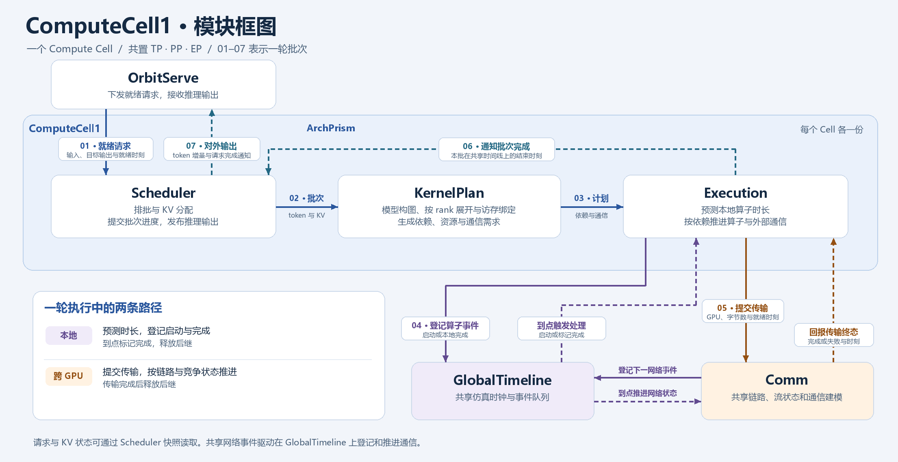
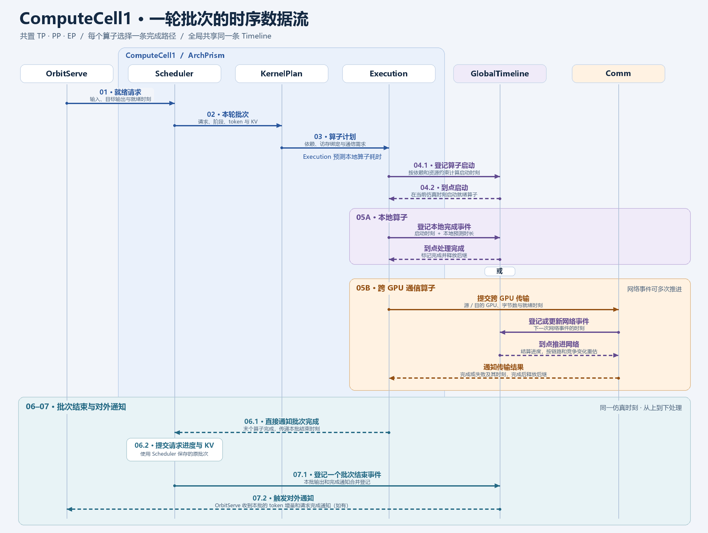
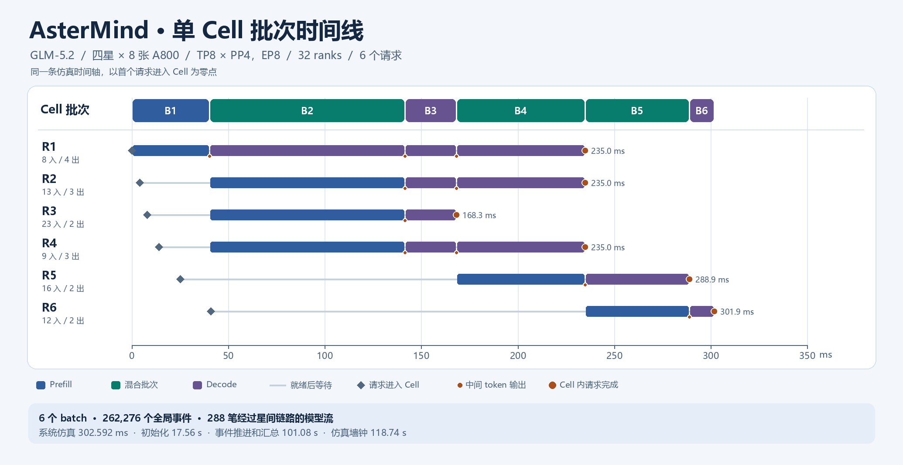
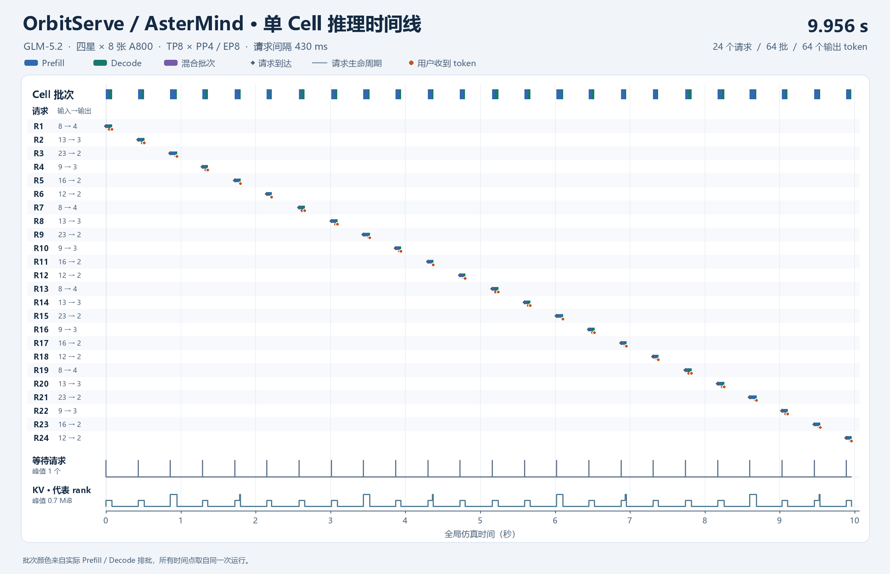

# AsterMind / ArchPrism

AsterMind 仿真 Compute Cell 的推理服务。每个 Cell 有独立的 Scheduler、KernelPlan 和 Execution，可使用不同的模型、硬件和 TP／PP／EP 配置。整次仿真共享一条 GlobalTimeline 和一套 Comm。

## 模块框图与批次时序





Scheduler 接收就绪请求并排批，保存当前批次。KernelPlan 把本批的 token 和 KV 操作转成带访存绑定的算子计划。Execution 预测本地算子耗时，在共享时间线上推进依赖。跨 GPU 算子就绪后提交给 Comm，由传输完成通知释放后继。

最后一个算子完成时，Execution 直接把本批结束时刻交给 Scheduler。Scheduler 提交保存的批次，更新请求进度和 KV，再在同一仿真时刻登记一个批次结束事件。该事件统一向 OrbitServe 发布本批的 token 增量与请求完成通知。请求与 KV 状态可通过 `snapshot()` 或 `report()` 读取。

KernelPlan 使用 `prepare_step` 生成计划。Execution 使用内置的 `predict_local_plan` 和预测缓存，并应用 eager Host 发射约束。vLLM 0.31 路径使用其原生排批和 OrbitServe 的 Cell 存储适配。

## 代码结构与模块接口

```text
simulator/engine.py                       场景总装和多 Cell 管理
src/astermind/
  cell.py                                  旧 Cell 入口的兼容导入
  cell_storage.py                          会话与 KV 存储
  pd_cell.py                              P/D 分离入口
  ArchPrism/
    scheduler/                            请求排批、KV 管理与批次提交
    midlayer/runtime.py                   KernelPlan 构图与算子展开
    execution/                            本地预测、事件推进与通信
src/orbitserve/runtime/timeline.py         共享时钟与事件队列
src/orbitserve/runtime/engine/network_events.py  共享网络事件驱动
src/network_sim/physical/                  物理拓扑与链路条件
src/network_sim/comm/                      路由、传输与链路竞争
```

| 模块 | 消费 | 处理和产出 |
|---|---|---|
| Scheduler | 就绪请求、当前 token 和 KV 状态、批次完成时刻 | 排批并提交进度，发布 token 增量和请求完成通知，提供状态快照 |
| KernelPlan | 批次内容、模型、硬件和 TP／PP／EP 配置 | 生成逐 rank 的算子、依赖、访存绑定和通信需求 |
| Execution | 算子计划、硬件和 rank 到 GPU 的映射 | 预测本地耗时，按共享 Timeline 推进事件，跨 GPU 操作交给 Comm，整批结束时通知 Scheduler |
| 物理网络 | 卫星和设备配置、轨道或静态建链参数 | 给 Comm 提供设备图与链路的可用状态、带宽和时延 |
| Comm 与共享时间线 | 传输的源／目的设备、字节数和就绪时刻，各模块登记的定时事件 | Comm 推进链路和流状态并交付传输终态。GlobalTimeline 按仿真时刻处理事件 |

## 单 Cell 实跑

合成场景为四颗卫星各 8 张 A800，运行一个 GLM-5.2 副本，`TP8 × PP4 / EP8` 共 32 个 rank。每颗星承载一个 PP 阶段，星内做 TP 和 EP，相邻阶段由 10 Gbps、单向传播时延 100 µs 的星间链路连接。6 个错峰请求在 6 轮批次中输出 16 个 token，其中 3 轮混合 Prefill 和 Decode。[场景配置](../../simulator/examples/glm52_single_cell_32ranks.json)

该配置采用 18／20／20／20 层分段、声明式因果 Top-K 和逐 rank 空工作区初始条件。改造后的 6 批起止时刻和算子数与下方记录逐项一致，跨 GPU 算子由 Comm 完成。



时间轴从首个请求进入 Cell 起算。B2 在 40.3 ms 排入 R1 的 Decode 与 R2、R3、R4 的 Prefill。系统统计从首个请求发出算到最后一个结果抵达用户。

| 开销 | 单次实测 |
|---|---:|
| 服务过程的仿真时间 | 302.592 ms |
| 初始化墙钟 | 17.56 s |
| 运行及内存结果汇总墙钟 | 101.08 s |
| 整次仿真墙钟 | **118.74 s** |

上表墙钟取自改造前的 WSL 运行，包含初始化、运行、汇总和关闭。审计、结果写盘与绘图另计。此场景处理了 262,276 个全局事件，执行审计通过。

```bash
python -m simulator --scenario simulator/examples/glm52_single_cell_32ranks.json --output simulator/runs/glm52_32ranks.json
```

## 约 10 秒的单 Cell 场景

同一四星配置下，24 个请求以 430 ms 等间隔到达，经过 64 轮批次输出 64 个 token。最后一个结果于模拟时间 9.956 s 送达，依赖和交付审计通过。时间线还记录了等待请求数与代表 rank 的 KV 占用。

改造前的对照中，同一份请求在独立计算仿真中也产生 64 轮批次。两边每批的排批内容、逻辑算子数和批内计时结果一致。本机带测时的仿真墙钟为 AsterMind 1,095.45 s、独立计算仿真 676.21 s。



```bash
python -m simulator.examples.make_glm52_single_cell_10s simulator/runs/glm52_10s.json
python -m simulator --scenario simulator/runs/glm52_10s.json --gc-gen2-threshold 400 --output simulator/runs/glm52_10s.result.json
python -m simulator.audit simulator/runs/glm52_10s.result.json --output simulator/runs/glm52_10s.audit.json
```
