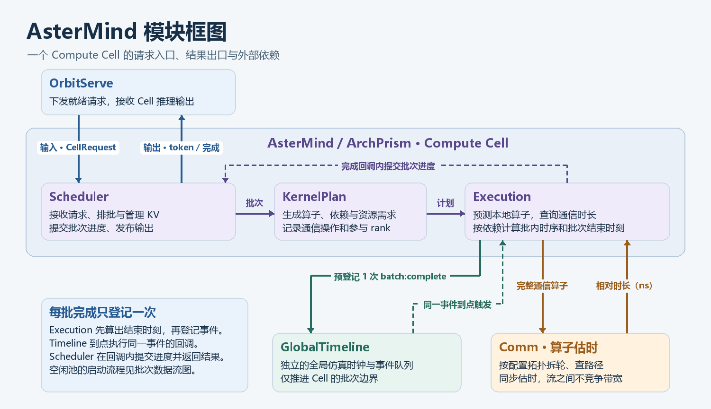
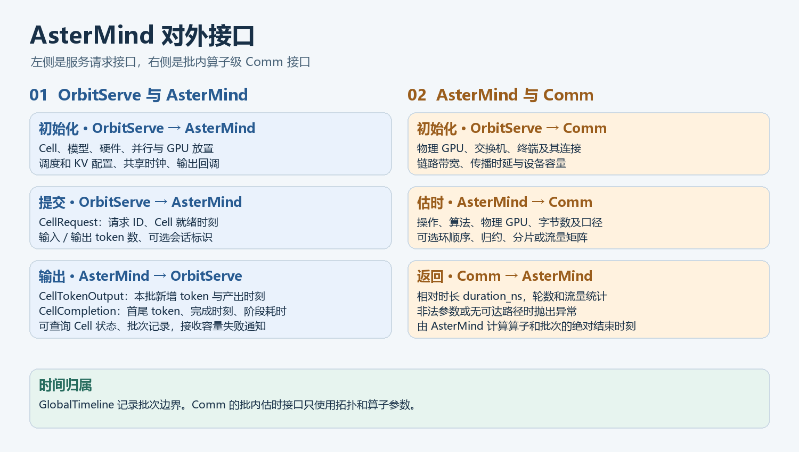
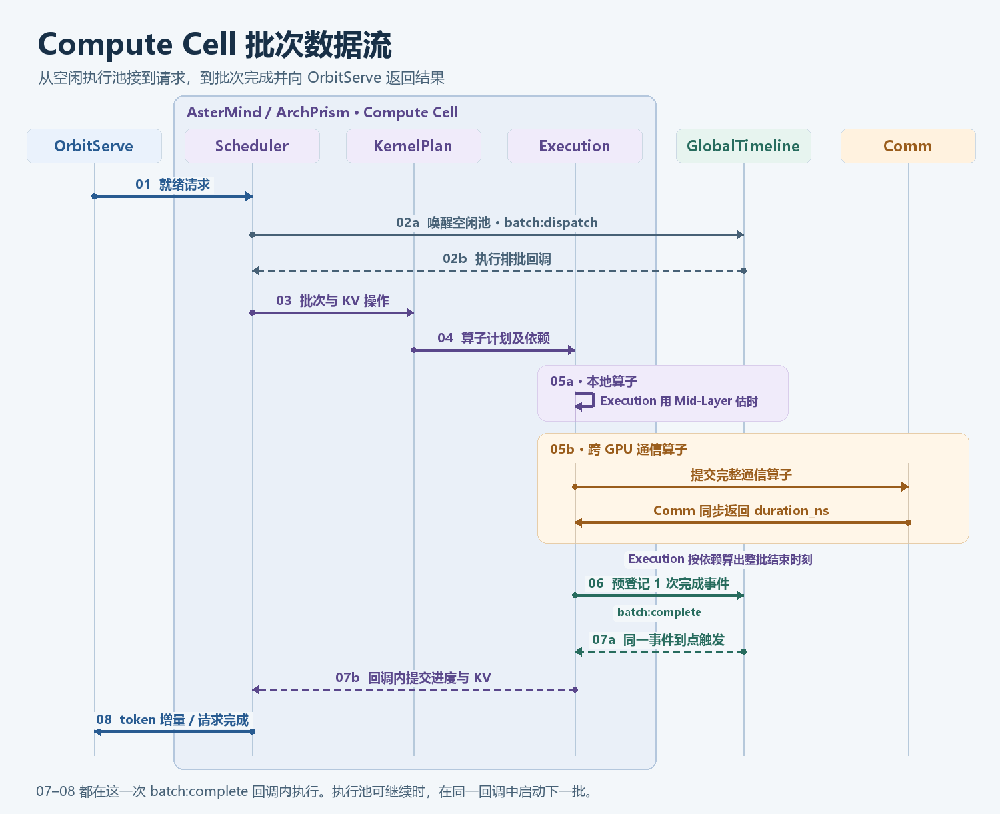

# AsterMind / ArchPrism

AsterMind 仿真一个 Compute Cell 的推理服务。OrbitServe 在请求抵达 Cell 后提交输入，在批次结束时接收新增 token 和请求完成通知。每个 Cell 有自己的 Scheduler、KernelPlan 和 Execution。多个 Cell 共用 OrbitServe 的 GlobalTimeline 和配置好的物理拓扑。

## 模块框图

| 模块 | 职责 |
|---|---|
| OrbitServe | 创建 Cell，负责请求接入、Cell 选择、用户侧交付与跨 Cell KV 迁移。 |
| Scheduler | 接收就绪请求，决定本批各请求的 Prefill／Decode、token 数和 KV 操作。空闲执行池通过 `batch:dispatch` 唤醒。批次完成时，在完成回调内提交进度并向 OrbitServe 回传结果。 |
| KernelPlan | 用 Mid-Layer 把批次变成带依赖的算子计划，记录本地算子的访存与资源需求，以及跨 GPU 算子的参与 rank、算法和数据量。 |
| Execution | 将逻辑 rank 映射到物理 GPU，用 Mid-Layer 预测本地算子，调用 Comm 估算通信算子。算出整批结束时刻后，**由 Execution 提前登记一次 `batch:complete`**。 |
| GlobalTimeline | 独立的全局仿真时钟与事件队列。对 Cell，负责空闲时触发排批和到点触发批次完成。 |
| Comm | 接收完整通信算子，按算法和物理拓扑拆分轮次、选择路径并返回相对时长。 |

## 对外接口

### OrbitServe 与 AsterMind

以共置 Cell 的 `main` 执行池为例。

| 调用 | 交换的信息 |
|---|---|
| 初始化 Cell | `ServingScheduler.create(...)` 接收 Cell ID、共享时钟、模型与硬件配置、批大小和 KV 策略、执行器及输出回调。执行器配置 TP／PP／EP 部署所对应的 rank 到物理 GPU 的放置，并持有算子级 Comm 接口。 |
| 提交请求 | `submit_ready_request(CellRequest)` 接收 Cell 内唯一的 `request_id`、`cell_ready_time_s`、`input_tokens` 和 `output_tokens`。提交时刻须等于 Cell 的当前仿真时刻。支持会话缓存的 Cell 可附 `session_id`、`context_id`、`parent_context_id`。 |
| 返回新增 token | `on_output(CellTokenOutput)` 提供 Cell 和请求 ID、从零起的 `token_start`、`token_count`、Cell 内的产出时刻以及是否为末段。OrbitServe 收到后安排用户侧交付。 |
| 返回请求完成 | `on_complete(CellCompletion)` 提供就绪、首次执行、首尾 token 和 Cell 内完成时刻，以及生成总量、Prefill／Decode 活跃时长。 |
| 查询与失败 | `snapshot()` 查询请求和 KV 状态，`report()` 读取批次与计时明细。容量无法满足时可通过 `on_failure` 接收通知。 |

例如，完整输入为 88 token、目标输出为 6 token 的续轮，提交 `input_tokens=88`、`output_tokens=6` 以及对应的会话与父上下文 ID。Scheduler 根据实际 KV 命中决定本轮仍需处理的 Prefill token 数。

[Scheduler 实现](ArchPrism/scheduler/serving.py) · [请求与输出结构](../orbitserve/runtime/engine/cell_events.py) · [OrbitServe 调用入口](../../simulator/engine.py)

### AsterMind 与 Comm

OrbitServe 在初始化时把物理拓扑交给 `OperatorCommunication`，包括 GPU、交换机、终端、已启用链路、带宽、传播时延和设备容量。每次批内通信，Execution 用 `estimate(CommunicationOperator)` 提交一个完整算子。

#### AsterMind 提交什么

| 字段 | 含义 | 例子与约束 |
|---|---|---|
| `operation` | 要完成什么通信操作。 | `all_reduce` 表示归约后每张卡都有结果，`send_recv` 表示源卡向目标卡发送，`all_to_all` 表示每张卡向其他卡交换各自的数据分片。 |
| `algorithm` | 用什么方式执行该操作。Comm 据此确定点对点传输及其轮次。 | `ring` 沿环逐轮传输，`pairwise` 按轮与不同的 peer 交换，`direct` 可用于源卡直接向各目标卡广播。流水线点对点传输用 `send_recv`。 |
| `participants` | 有顺序的物理 GPU ID 列表。Execution 先把逻辑 rank 映射成这些 ID。 | 至少两个不同 GPU。点对点依次填源和目的，广播第一项为源。变长分片和 AllToAll 矩阵按这里的顺序索引。 |
| `bytes` | 用于描述这次操作的数据量。单位是字节，取非负整数。 | 例如 `1048576` 表示 1 MiB。这个数字属于每张卡、单份消息还是所有参与者，取决于 `bytes_semantics`。 |
| `bytes_semantics` | 指定 `bytes` 的统计口径。 | `payload` 是单份消息字节数，用于点对点和广播。广播的每个目标都收到这份消息。 `per_rank_input` 是每张卡的输入字节数，例如等量 AllReduce。 `aggregate_input` 是所有参与者的输入字节和，用于 AllGatherV。显式 AllToAll 则用它表示矩阵中全部非本地传输字节的总和。 |
| `ring_order` | 环上物理 GPU 的顺序。 | 环中每个参与 GPU 恰好出现一次。最后一张卡的下一跳是第一张卡。非环形操作填空。 |
| `reduction` | 算子采用的归约方式。 | AllReduce 和 ReduceScatterV 的构图规则填 `"sum"`。AllGather、AllGatherV 和 PP 点对点传输填 `None`。环形 AllReduce 还要求每卡输入字节数可以按参与者数均分。 |
| `partition_bytes` | 变长集合通信中，每个 GPU 对应的分片字节数。 | AllGatherV 对应每张卡贡献的输入分片，ReduceScatterV 对应每张卡收到的输出分片。两种操作的 `bytes` 都等于分片之和，对 ReduceScatterV 这也是一张卡的完整输入大小。 |
| `traffic_matrix_bytes` | 显式 AllToAll 的传输矩阵。第 `i` 行第 `j` 列表示第 `i` 张卡发给第 `j` 张卡的字节数。 | 矩阵为 `N × N`，对角线填 0。总和等于 `bytes`。省略矩阵时，等量 AllToAll 将每卡输入均分成 `N` 份，本地那份留在原卡。 |

例如，4 张卡做环形求和 AllReduce，每张卡输入 1 MiB，传入 `operation="all_reduce"`、`algorithm="ring"`、`bytes=1048576`、`bytes_semantics="per_rank_input"`，以及物理 GPU ID、环顺序和 `reduction="sum"`。Comm 将每卡数据均分为 4 份，每份 256 KiB，按 6 轮展开。每轮每张卡向环上的下一张卡发一个分片。

#### Comm 返回什么

| 字段 | 含义 |
|---|---|
| `duration_ns` | 从该算子开始执行算起的相对时长，单位为整数纳秒。Execution 用它和算子依赖推导绝对结束时刻。 |
| `rounds`、`flow_count` | Comm 展开的轮数和点对点传输数。4 卡 AllReduce 的例子中分别为 6 和 24。 |
| `cross_satellite_flows`、`cross_satellite_bytes` | 源 GPU 和目的 GPU 位于不同卫星的传输数及其字节总和。 |

Comm 按轮次展开点对点流，在配置拓扑上查物理路径。每条流按路径瓶颈带宽和传播时延估算，同轮取最长时长，轮间累加。批内估时不读取或推进 GlobalTimeline，也不模拟流之间的带宽竞争。

参数非法或路径不可达时抛出 `ValueError`。尚未实现的算子或算法分支会抛出 `NotImplementedError`。

[Comm 调用示例](../network_sim/docs/compute-handoff.md#astermind-的算子级估时) · [算子估时代码](../network_sim/comm/operator.py)

## 一轮批次的数据流

1. **请求进入。** OrbitServe 在输入到达 Cell 时调用 Scheduler。执行池空闲时，Scheduler 登记 `batch:dispatch`，由 GlobalTimeline 触发排批。已有批次运行时，新请求进入等待队列。
2. **构造算子计划。** Scheduler 将 `BackendStep` 交给 KernelPlan，带上各请求本批的阶段、token 数、已有上下文和 KV 操作。KernelPlan 将算子、依赖和资源约束交给 Execution。
3. **批内估时。** 图中 05a 是本地算子，由 Execution 调用 Mid-Layer 估时。05b 是跨 GPU 通信算子，由 Execution 提交完整算子，Comm 同步返回相对时长。Execution 结合两类时长、前驱依赖和资源顺序计算各算子起止时刻，独立分支可以重叠。
4. **登记一次批次完成。** Execution 取最晚结束的算子时刻，预先登记一个 `batch:complete`。批内算子和链路流的时序只保存在批次报告中。
5. **到点返回结果。** GlobalTimeline 到点执行这一次 `batch:complete` 的回调。Scheduler 在回调内提交请求和 KV 进度，向 OrbitServe 发布 token 增量与已完成请求，并在执行池可继续时启动下一批。

AsterMind 的请求、产出和批次边界使用同一个仿真时钟，公开时刻以秒表示。Comm 返回的纳秒时长由 Execution 纳入批内计算。用户接收 token 的时刻由 OrbitServe 单独记录。请求上传、用户交付、P/D KV 交接和跨 Cell KV 迁移走批外系统传输接口。

[批次执行器](ArchPrism/execution/network_batch_executor.py) · [GlobalTimeline](../orbitserve/runtime/timeline.py) · [批外系统传输](../network_sim/docs/compute-handoff.md#批外系统传输v02)

## 代码入口

| 查找内容 | 入口 |
|---|---|
| 场景初始化、请求接入、用户交付 | [simulator/engine.py](../../simulator/engine.py) |
| 排批、KV 进度与输出回调 | [ArchPrism/scheduler/serving.py](ArchPrism/scheduler/serving.py) |
| 模型配置、构图与批次适配 | [ArchPrism/midlayer/runtime.py](ArchPrism/midlayer/runtime.py) |
| GPU 放置与批内依赖时序 | [placement.py](ArchPrism/execution/placement.py) · [network_batch_executor.py](ArchPrism/execution/network_batch_executor.py) |
| 会话历史与 P/D 交接 | [cell_storage.py](cell_storage.py) · [pd_cell.py](pd_cell.py) |
| 全局事件队列与批内通信 | [timeline.py](../orbitserve/runtime/timeline.py) · [operator.py](../network_sim/comm/operator.py) |
