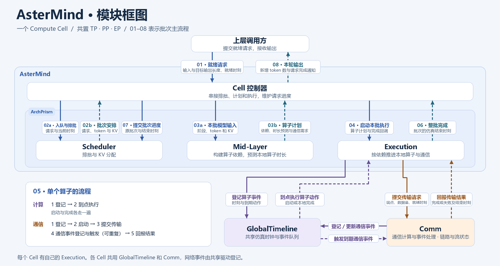
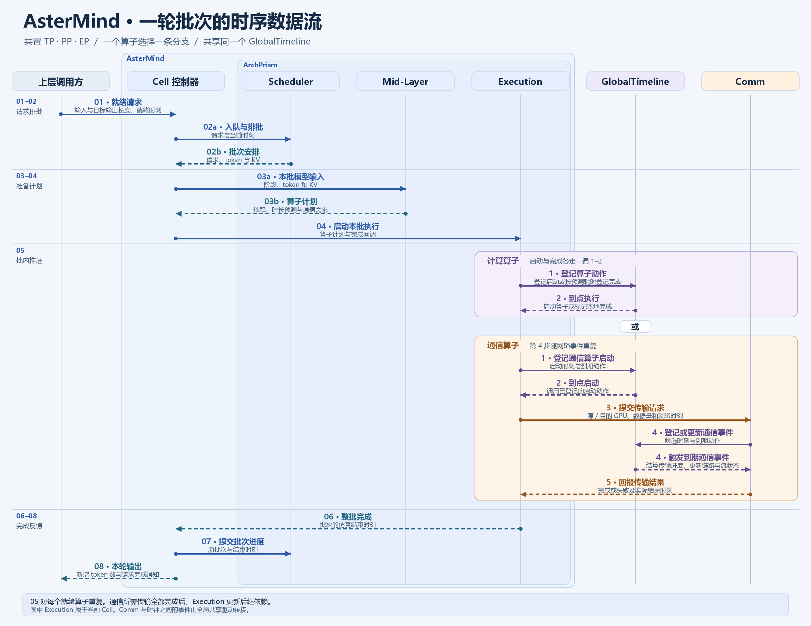

# AsterMind / ArchPrism

AsterMind 仿真一个 Compute Cell 的推理服务。每个 Cell 有独立的 Scheduler、Mid-Layer 和 Execution，可使用不同的模型、硬件和 TP／PP／EP 配置。整次仿真共享一条 GlobalTimeline 和一套 Comm。

## 模块框图与批次时序





Cell 把收到的请求交给 Scheduler 排批。Mid-Layer 把本批的 token 和 KV 操作转成算子计划，Execution 按依赖推进本地计算和跨 GPU 通信。一批完成后，Cell 提交批次结果，Scheduler 更新请求进度和 KV 状态，Cell 对外输出生成的 token 或请求完成结果。

## 代码结构与模块接口

```text
simulator/engine.py                       场景总装和多 Cell 管理
src/astermind/
  cell.py、cell_storage.py                 共置推理、请求状态与 KV 存储
  pd_cell.py                              P/D 分离入口
  ArchPrism/
    scheduler/                            请求排批与 KV 管理
    midlayer/                             生成算子计划和本地耗时
    execution/                            推进算子依赖与通信
src/orbitserve/runtime/timeline.py         共享时钟与事件队列
src/orbitserve/runtime/engine/network_events.py  共享网络事件驱动
src/network_sim/physical/                  物理拓扑与链路条件
src/network_sim/comm/                      路由、传输与链路竞争
```

| 模块 | 消费 | 处理和产出 |
|---|---|---|
| Cell 控制器 | OrbitServe 下发的请求、Execution 的批次完成结果 | 管理 Cell 内推理进度，连接排批、建模和执行，对 OrbitServe 输出 token 增量或请求终态 |
| Scheduler | 待处理请求、当前 token 和 KV 状态 | 选择一轮 Prefill／Decode 任务，给 Mid-Layer 提供批次内容和 KV 操作，批次完成后更新进度 |
| Mid-Layer | 批次内容、模型、硬件和 TP／PP／EP 配置 | 给 Execution 生成算子依赖、通信需求与本地算子预测耗时 |
| Execution | 算子计划、耗时预测、rank 到 GPU 的映射 | 以批次为单位管理算子依赖。跨 GPU 操作交给 Comm，整批完成时通知 Cell |
| 物理网络 | 卫星和设备配置、轨道或静态建链参数 | 给 Comm 提供设备图与链路的可用状态、带宽和时延 |
| Comm 与共享时间线 | 传输的源／目的设备、字节数和就绪时刻，各模块登记的定时事件 | Comm 推进链路和流状态并交付传输终态。GlobalTimeline 按仿真时刻处理事件 |

## 单 Cell 实跑

合成场景为四颗卫星各 8 张 A800，运行一个 GLM-5.2 副本，`TP8 × PP4 / EP8` 共 32 个 rank。每颗星承载一个 PP 阶段，星内做 TP 和 EP，相邻阶段由 10 Gbps、单向传播时延 100 µs 的星间链路连接。6 个错峰请求在 6 轮批次中输出 16 个 token，其中 3 轮混合 Prefill 和 Decode。[场景配置](../../simulator/examples/glm52_single_cell_32ranks.json)

该配置复用 Mid-Layer 的 18／20／20／20 层分段、声明式因果 Top-K 和逐 rank 空工作区初始条件。


时间轴从首个请求进入 Cell 起算。B2 在 40.3 ms 排入 R1 的 Decode 与 R2、R3、R4 的 Prefill。系统统计从首个请求发出算到最后一个结果抵达用户。

| 开销 | 单次实测 |
|---|---:|
| 服务过程的仿真时间 | 302.592 ms |
| 初始化墙钟 | 17.56 s |
| 运行及内存结果汇总墙钟 | 101.08 s |
| 整次仿真墙钟 | **118.74 s** |

在本机 WSL 的 CPU 环境测量，整次墙钟包含初始化、运行、汇总和关闭。审计、结果写盘与绘图另计。此场景处理了 262,276 个全局事件，执行审计通过。运行阶段的 Mid-Layer 构图、算子生成、耗时预测和内部计划汇总共 59.32 s。

```bash
python -m simulator --scenario simulator/examples/glm52_single_cell_32ranks.json --output simulator/runs/glm52_32ranks.json
```
