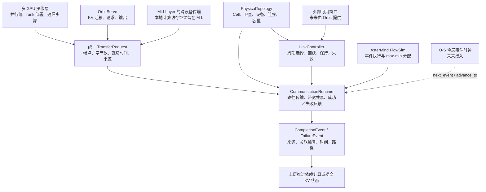
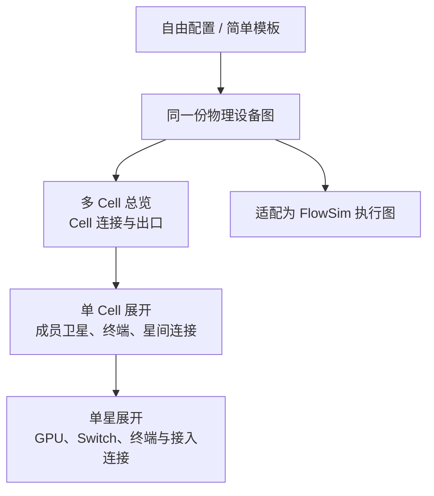
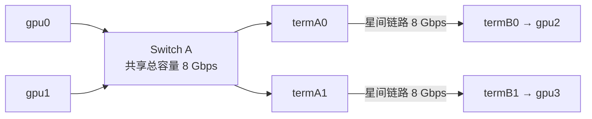
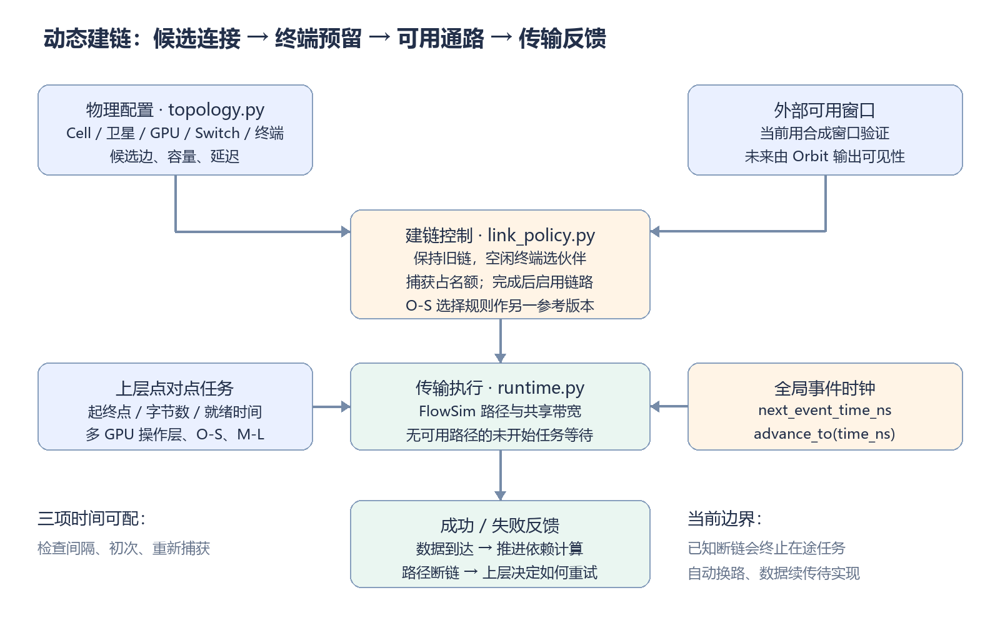

# 架构图：先看职责，再看设备，最后看共享

[浏览器版三张图](architecture.html)无需外部依赖，点击顶部按钮切换。

静态图可以直接查看：[框架](architecture.png)、[设备](devices.png)、[共享](sharing.png)。静态图不执行 HTML 或脚本。

## 第一层：模块之间交换什么



前三个输入方尚未接入；它们共用的任务契约和外部时钟接口已经实现。通信模块不展开 TP／PP 集合通信，也不管理 KV 的显存归属。上层只需要理解任务及其完成事件，不需要理解交换机内部通路。

## 第二层：同一份拓扑的三个视角



成员关系不是传输边。例如 GPU 属于卫星，并不意味着与这颗卫星的所有终端自动连通。具体接入关系由模板或自由边配置表达。

## 第三层：Switch 如何形成共享瓶颈



两条链路各有 8 Gbps，不代表两笔任务能同时各拿 8 Gbps，因为它们共用总容量为 8 Gbps 的 Switch。适配器将这个设备拆成内部入口、出口以及一条容量通路：

```text
各端口进入 → Switch入口 ── 8 Gbps共享容量 ──→ Switch出口 → 各端口离开
```

两个方向的经过流量都使用该内部通路。它是总容量约束的等效表达，不是物理上增加一台交换机；对外路径仍只显示一次 Switch。该转换使 FlowSim 原有链路分配器直接处理设备总容量，保持路由与共享在同一个引擎里。

GPU 则拆成独立入口和出口，二者没有转发通路，因此不会误把 GPU 当作隐式路由器。

## 从图找到代码

| 图中的内容 | 代码 |
|---|---|
| 自由配置、任务和事件 | `physical/model.py`、`comm/model.py` |
| Cell 成员、设备连接和容量转换 | `physical/topology.py` |
| 三层查询 | `PhysicalTopology.view` |
| 周期建链、终端预留、捕获与失效 | `physical/link_policy.py` |
| 提交、查询、外部时钟、反馈 | `comm/runtime.py` |
| Python 与 C++ 连接 | `comm/native/bridge.cc` |
| 事件推进与共享分配 | `comm/_vendor/flowsim/src/event_simulator.cc` |
| 路径搜索 | `comm/_vendor/flowsim/src/topology.cc` |
| 独立运行入口 | `__main__.py` |
| 路径、竞争及时序验证 | `tests/test_network.py` |
| 最小公开包 | `package_release.py` |

动态建链已接入运行时，已知可用窗口结束会终止在途任务。O-S 通用／Walker 连接选择可作参考分支。自动轨道／可见性计算和断链续传尚未接入。



图中控制器管理候选与终端名额；捕获完成才把链路启用到 FlowSim。失效反馈到上层，不自动恢复失败任务。
