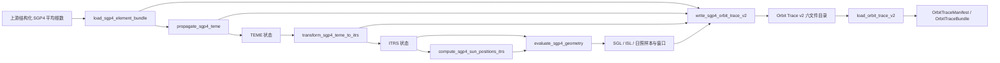
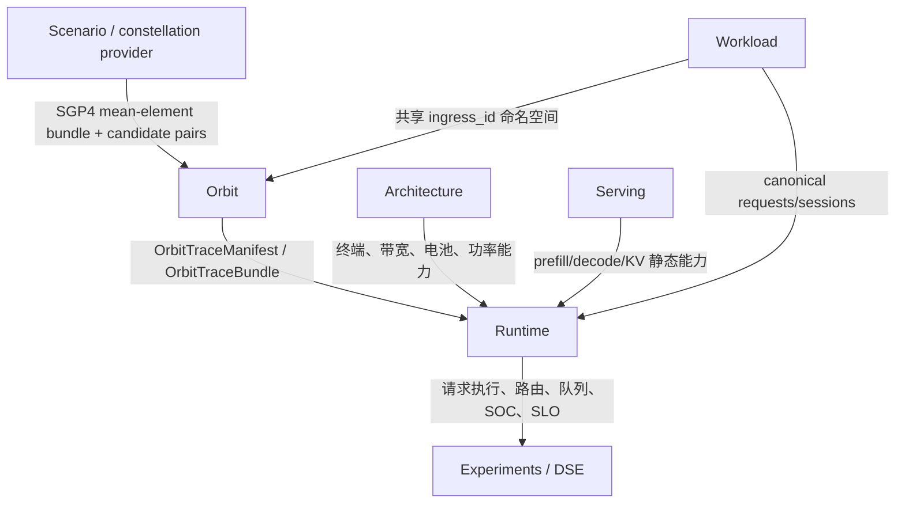

# Orbit 模块交接与跨模块联调说明

> 更新时间：2026-07-21  
> 适用对象：Runtime/Workload/Architecture/Experiments/DSE 负责人，以及接手本项目的新 Agent  
> 当前结论：Orbit 模块内可独立完成的开发已经完成；SGP4 路径可生成纯几何 Orbit Trace v2，但尚未切换为默认模型，也尚未接入完整 Runtime/DSE 路径。

## 1. 阅读顺序

接手者建议按以下顺序阅读：

1. 本文：快速理解现状、接口和责任边界。
2. [`TRACE_CONTRACT.md`](TRACE_CONTRACT.md)：Orbit Trace v2、确定性输出和兼容迁移合同。
3. [`SGP4_INPUT_CONTRACT.md`](SGP4_INPUT_CONTRACT.md)：SGP4 平均根数输入、单位、验证及来源合同。
4. [`__init__.py`](__init__.py)：唯一允许其他模块依赖的 Orbit Python 公开入口。
5. `tests/unit/orbit/`：当前行为的可执行合同。

本文是交接指南，不替代上述冻结合同。发生冲突时，应先由数据提供方和使用方共同确认合同变更，再修改代码与测试。

## 2. Orbit 模块负责什么

Orbit 是确定性的物理几何和空间环境事实生产者。

Orbit 负责：

- 卫星稳定身份与轨道输入验证；
- 轨道位置和速度传播；
- 坐标系转换；
- 地面到卫星的几何可见性；
- 候选卫星对之间的几何可见性；
- 日照和阴影状态；
- 几何 Trace 的规范化、哈希、写入与校验回读。

Orbit 不负责：

- 链路带宽和有效容量；
- 通信终端数量、占用、分配和建立时延；
- active graph；
- 路由、队列、拥塞和请求调度；
- 模型部署位置和 KV 迁移策略；
- DVFS；
- 初始 SOC、当前 SOC、充放电和运行后能源状态；
- 根据 Workload 或 SLO 反推硬件、轨道或星座配置。

以上非 Orbit 数据由 Architecture、Runtime、Workload、Serving 或 Experiments/DSE 各自拥有。

## 3. 当前同时存在的两条轨道路径

### 3.1 旧的默认圆轨道路径

当前 `run_simulation` 和既有实验仍默认使用旧路径。该路径主要位于：

- [`orbit_traces.py`](orbit_traces.py)
- [`simulation.py`](simulation.py)
- [`simulation_trace_builder.py`](simulation_trace_builder.py)

它使用圆轨道两体传播、简化地球自转/坐标转换、球形地球地面几何和简化阴影模型。该路径用于保持现有 Runtime、integration、smoke 和历史示例可运行。

不要在未经跨模块确认的情况下删除、改写或默认替换这条路径。

### 3.2 新的 opt-in SGP4 路径

新的高精度路径已经完整实现，但必须显式调用：



当前实现没有让 Runtime 直接调用 SGP4。Runtime 的正确边界是只消费 Orbit Trace 公开结果。

## 4. SGP4 路径的模型定义

### 4.1 输入语义

权威输入不是两行固定宽度 TLE 文本，而是结构化、全精度的 SGP4 平均根数：

- schema：`orbitserve.sgp4_element_bundle.v1`
- element semantics：`sgp4_mean_elements`
- gravity model：`wgs72`
- operation mode：`improved`
- time scale：`utc`

每颗卫星必须包含：

| 类别 | 字段 |
|---|---|
| 稳定身份 | `satellite_id`、`satnum`、`classification`、`object_id` |
| epoch | `epoch_utc`，格式必须为 `YYYY-MM-DDTHH:MM:SS.ffffffZ` |
| 平均根数 | `inclination_deg`、`raan_deg`、`eccentricity`、`argument_of_perigee_deg`、`mean_anomaly_deg`、`mean_motion_rev_per_day` |
| SGP4 修正项 | `mean_motion_dot_rev_per_day2`、`mean_motion_ddot_rev_per_day3`、`bstar_inv_earth_radii` |
| 编目字段 | `ephemeris_type`、`element_set_number`、`revolution_number_at_epoch` |

输入还必须声明来源：

- `synthetic_sgp4_mean_elements`：合成平均根数，`observationally_fitted=false`；
- `observationally_fitted_general_perturbations`：观测拟合根数，`observationally_fitted=true`。

不能把瞬时 Cartesian 状态、经典开普勒根数或旧圆轨道配置简单改名后伪装为 SGP4 平均根数。

### 4.2 为什么不直接读取 TLE 两行文本

TLE 固定宽度文本会量化和截断数值。当前合同规定：

- 结构化全精度字段是传播权威；
- Orbit 直接使用这些字段初始化 SGP4；
- `tle_line1`、`tle_line2` 不属于 v1 输入，出现时会作为未知字段被拒绝；
- 如将来需要 TLE 审计文件，应新增确定性的格式化器，但生产传播不能再读回量化后的文本。

当前尚未实现审计用 TLE 文本格式化器，因为它不是传播链路的必要条件。

### 4.3 传播与坐标系

| 阶段 | 当前实现 |
|---|---|
| SGP4 引擎 | `python-sgp4==2.27` |
| 重力常数 | WGS-72 |
| operation mode | improved |
| SGP4 输出坐标系 | TEME |
| TEME→地固转换 | `astropy==6.1.3` |
| 地固坐标系 | ITRS |
| 网络数据更新 | 禁止 |

传播结果单位：

- 位置：km；
- 速度：km/s；
- 相对时间：s；
- simulation epoch：UTC。

SGP4 任意一颗卫星初始化失败或任意一个样本传播失败，整个调用失败；不会用零位置、旧位置或部分结果代替。

### 4.4 固定 Earth-orientation 数据

默认数据目录：

`data/iers/0.2026.5.11.1.8.52/`

| 文件 | SHA-256 |
|---|---|
| `finals2000A.all` | `eeb76193cd43c065b763d78923f8a8ce2f8a62df5d3e1519a3217fac433bdaa6` |
| `ReadMe.finals2000A` | `7c6182cc0fd0cbece39711f648d15e48b49168925602e360a5709c5ccc8d5a12` |
| `Leap_Second.dat` | `6f7bc6a25841bc394f82bdfd5d7bb22ffcd4548ee28e9822f2927a909e4f912f` |

数据来源版本为 `astropy-iers-data-0.2026.5.11.1.8.52`。IERS 表覆盖 MJD 41684 至 61533；当前闰秒文件声明 2026-12-28 到期，代码在到期时刻前停止接受样本。项目标准 epoch `2026-07-20` 在覆盖范围内，并会标记为 predictive Earth-orientation 数据。

运行时不会联网下载 IERS 数据。文件缺失、哈希变化、数据范围不足或闰秒有效期不足均会失败关闭。

### 4.5 几何模型

| 几何事实 | 当前模型 |
|---|---|
| Ground ingress | WGS-84 椭球上的 geodetic 经纬度和高度 |
| SGL 可见性 | 卫星 ITRS 位置相对站点本地 geodetic up 的 elevation |
| ISL 可见性 | 候选卫星线段是否穿过带可选 margin 的 WGS-84 椭球 |
| 太阳位置 | Astropy geocentric Sun，使用相同固定 IERS/闰秒来源变换到 ITRS |
| 日照/阴影 | IAU nominal solar radius 下的锥形本影模型 |
| 窗口边界 | 相邻样本 signed boundary function 的确定性线性插值 |

当前常量：

- WGS-84 semi-major axis：6378.137 km；
- WGS-84 flattening：`1 / 298.257223563`；
- IAU nominal solar radius：695700 km；
- 光速：299792.458 km/s。

Orbit 只计算调用方显式提供的 ISL candidate pairs。选择同轨相邻、跨轨相邻、mesh、ring 或动态拓扑属于调用方/Runtime 策略，不由 Orbit 推断。

## 5. 公开 Python 接口

其他模块只能从 `orbitserve.orbit` 导入以下公开入口，不得导入 `orbitserve.orbit.sgp4_*` 内部文件或私有函数。

| 阶段 | 公开入口 | 输入 | 输出 |
|---|---|---|---|
| 元素验证 | `load_sgp4_element_bundle` | JSON path、mapping 或 `Sgp4ElementBundle` | `Sgp4ElementBundle` |
| TEME 传播 | `propagate_sgp4_teme` | element bundle、simulation epoch、sample times | `Sgp4PropagationResult` |
| ITRS 转换 | `transform_sgp4_teme_to_itrs` | `Sgp4PropagationResult` | `Sgp4EarthFixedResult` |
| 太阳位置 | `compute_sgp4_sun_positions_itrs` | `Sgp4EarthFixedResult` | `Sgp4SunPositionResult` |
| 几何计算 | `evaluate_sgp4_geometry` | Earth-fixed result、ground ingresses、ISL pairs | `Sgp4GeometryResult` |
| SGP4 Trace 写入 | `write_sgp4_orbit_trace_v2` | 上述 bundle/results | `OrbitTraceManifest` |
| Trace 校验回读 | `load_orbit_trace_v2` | manifest path/mapping | `OrbitTraceBundle` |
| 通用 Trace v2 写入 | `write_orbit_trace_v2` | 已准备好的纯几何记录 | `OrbitTraceManifest` |

主要公开数据类型：

- `Sgp4ElementBundle`
- `Sgp4SatelliteElements`
- `Sgp4ElementProvenance`
- `Sgp4PropagationResult` / `Sgp4TemeSample`
- `Sgp4EarthFixedResult` / `Sgp4ItrsSample`
- `Sgp4SunPositionResult` / `Sgp4SunPositionSample`
- `Sgp4GroundIngress`
- `Sgp4GeometryResult`
- `Sgp4SglGeometrySample` / `Sgp4SglWindow`
- `Sgp4IslGeometrySample` / `Sgp4IslWindow`
- `Sgp4SunlightGeometrySample` / `Sgp4SunlightWindow`
- `OrbitTraceManifest`
- `OrbitTraceBundle`

`RuntimeTraceManifest` 和 `RuntimeTraceBundle` 暂时保留为兼容别名，并与对应 `OrbitTrace*` 类型对象完全相同。新代码应使用 `OrbitTrace*` 名称。

## 6. 标准调用示例

```python
from orbitserve.orbit import (
    compute_sgp4_sun_positions_itrs,
    evaluate_sgp4_geometry,
    load_orbit_trace_v2,
    load_sgp4_element_bundle,
    propagate_sgp4_teme,
    transform_sgp4_teme_to_itrs,
    write_sgp4_orbit_trace_v2,
)

elements = load_sgp4_element_bundle("scenario_sgp4_elements.json")

# Trace v2 适配器要求均匀网格，并把最后一个采样时刻作为半开窗口的 end_s。
sample_times_s = tuple(float(value) for value in range(0, 3600 + 60, 60))

propagation = propagate_sgp4_teme(
    elements,
    simulation_epoch_utc="2026-07-20T00:00:00.000000Z",
    sample_times_s=sample_times_s,
)

earth_fixed = transform_sgp4_teme_to_itrs(propagation)
sun_positions = compute_sgp4_sun_positions_itrs(earth_fixed)

geometry = evaluate_sgp4_geometry(
    earth_fixed,
    ground_ingresses=(
        {
            "ingress_id": "gateway:beijing",
            "lat_deg": 39.9042,
            "lon_deg": 116.4074,
            "altitude_km": 0.05,
            "min_elevation_deg": 10.0,
        },
    ),
    # Orbit 只计算这些 pair 的几何事实，不决定这些 pair 为什么被选择。
    isl_pairs=(("sat-00001", "sat-00002"),),
    isl_clearance_km=0.0,
    shadow_atmosphere_margin_km=0.0,
    sun_positions=sun_positions,
)

manifest = write_sgp4_orbit_trace_v2(
    "results/orbit/sgp4_case",
    elements=elements,
    propagation=propagation,
    earth_fixed=earth_fixed,
    geometry=geometry,
    # Orbit 不会根据 synthetic/fitted 来源自动把结果提升为正式实验证据。
    valid_for_paper_main_results=False,
)

bundle = load_orbit_trace_v2(
    "results/orbit/sgp4_case/trace_manifest.json"
)
```

调用方必须确保输出目录不存在或为空。Trace writer 不覆盖已有非空目录。

## 7. Orbit Trace v2 输出合同

### 7.1 文件集合

`write_sgp4_orbit_trace_v2` 最终通过公共 `write_orbit_trace_v2` 生成：

1. `trace_manifest.json`
2. `satellite_catalog.json`
3. `ephemeris_trace.json`
4. `sgl_windows.json`
5. `isl_windows.json`
6. `sunlight_windows.json`

每个数据文件都包含：

- `schema_version`；
- `trace_id`；
- `kind`；
- canonical `records` 数组。

### 7.2 Manifest

Manifest 至少记录：

- schema：`orbitserve.orbit_trace.v2`；
- scope：`orbit_geometry_only`；
- trace model：`sgp4-wgs72-teme-astropy-itrs-wgs84-v1`；
- epoch、start/end/duration/step；
- 六文件相对路径；
- 每个数据文件的 SHA-256；
- manifest content SHA-256；
- element、SGP4、Astropy、IERS、geometry 和 adapter provenance；
- warnings；
- `valid_for_paper_main_results`。

### 7.3 Satellite catalog

SGP4 路径的 satellite catalog 当前保存每颗卫星的完整 canonical SGP4 mean-element record。`satellite_id` 是 Orbit/Runtime 使用的稳定身份；`satnum` 和 `object_id` 是外部编目身份，不能代替 `satellite_id`。

当前 SGP4 bundle 没有轨道面、轨道集合或 formation cluster 的逻辑身份字段。Orbit 不能从 TLE/SGP4 根数无歧义地恢复这些业务身份。如果 Runtime 部署需要这些字段，必须由上游数据提供方、Orbit 和 Runtime 共同冻结扩展合同。

### 7.4 Ephemeris

SGP4 Trace 同时保存两套显式字段：

- `position_teme_km`
- `velocity_teme_km_s`
- `position_itrs_km`
- `velocity_itrs_km_s`
- `source_reference_frame="TEME"`
- `earth_fixed_reference_frame="ITRS"`

新 SGP4 路径不输出含义模糊的 `r_eci_km`。旧路径是否删除或版本化该字段仍属于兼容迁移决策。

### 7.5 SGL windows

基础字段：

- `ingress_id`
- `satellite_id`
- `start_s`
- `end_s`
- `duration_s`
- `sgl_link_id`
- `window_id`

几何统计字段：

- `propagation_delay_min_s` / `propagation_delay_max_s`
- `slant_range_min_km` / `slant_range_max_km`
- `elevation_min_deg` / `elevation_max_deg`
- `geometry_model`

窗口语义为左闭右开 `[start_s, end_s)`。

### 7.6 ISL windows

基础字段：

- canonical `endpoint_a` / `endpoint_b`
- `start_s`
- `end_s`
- `duration_s`
- `link_id`
- `window_id`

几何统计字段：

- `propagation_delay_min_s` / `propagation_delay_max_s`
- `distance_min_km` / `distance_max_km`
- `earth_clearance_min_km` / `earth_clearance_max_km`
- `geometry_model`

这些字段只表示几何上能否建立链路，不表示 Runtime 已激活、保留或使用该链路。

### 7.7 Sunlight windows

字段包括：

- `satellite_id`
- `start_s`
- `end_s`
- `duration_s`
- `sunlit`
- `eclipsed`
- `shadow_margin_min_km` / `shadow_margin_max_km`
- `sun_distance_min_km` / `sun_distance_max_km`
- `geometry_model`
- `window_id`

`sunlit` 和 `eclipsed` 必须互为逻辑反值。

## 8. 确定性与失败关闭规则

### 8.1 字节级可复现

在 canonical 输入、代码、schema、算法版本和固定数据相同时，输出要求字节级一致：

- 卫星按 `satellite_id` 排序；
- ephemeris 按 `(time_s, satellite_id)` 排序；
- ISL endpoint canonical 排序；
- warning 去重并排序；
- JSON key 字典序排序；
- UTF-8、无 BOM、LF、恰好一个结尾换行；
- 时间和窗口边界保留九位小数规范；
- 其他浮点数规范为 15 位有效数字；
- `-0.0` 规范为 `0.0`；
- 禁止 NaN 和 Infinity；
- 输出路径、主机名、进程 ID 和生成时间不参与 identity，也不写入 provenance。

`trace_id` 来自 canonical 几何内容和算法版本，不来自输出目录。Manifest 的 self-hash 在计算时排除 self-hash 字段本身。

### 8.2 完整失败

以下情况会在写盘前失败：

- element bundle schema、字段、类型、单位或 provenance 错误；
- 重复 `satellite_id` 或 `satnum`；
- SGP4 初始化或任意样本传播错误；
- IERS/闰秒文件缺失、哈希不符或不覆盖样本时间；
- TEME 与 ITRS 的 `(time_s, satellite_id)` 不完全一致；
- element set ID、simulation epoch 或算法/data provenance 不一致；
- geometry sample grid 不完整；
- Trace v2 sample grid 不均匀；
- window 越界、为空或引用未知卫星；
- 输出目录已存在且非空；
- 出现 Runtime/Architecture-owned 字段；
- 出现 host/output-specific metadata。

当前生产路径不支持“部分成功但继续写出”的 trace。

## 9. 跨模块联调合同

### 9.1 总体数据流



### 9.2 上游 Scenario/Constellation provider → Orbit

提供方必须：

- 通过公开 `Sgp4ElementBundle` 合同提供 SGP4-compatible mean elements；
- 保证 `satellite_id` 稳定且全局可与 Runtime 部署引用对齐；
- 明确 synthetic 或 observationally fitted provenance；
- 提供 simulation epoch 和均匀 sample grid；
- 提供 ground ingress 经纬度、高度和最低 elevation；
- 显式提供需要检查的 ISL candidate pairs；
- 不向 Orbit 输入带宽、终端分配、路由、队列或 SOC。

提供方不能：

- 直接导入 `sgp4_elements.py` 或其他 Orbit 内部文件；
- 提供 TLE 两行文本并要求 Orbit 把它当作权威输入；
- 把 osculating/Keplerian 元素假称为 SGP4 mean elements；
- 假设 Orbit 会自动生成网络拓扑。

待共同确认：是否扩展 element/catalog contract，携带 orbital set、plane、cluster 或部署拓扑身份。该信息不能由 Orbit 单方面猜测。

### 9.3 Workload ↔ Orbit

唯一直接共享的业务命名空间是 `ingress_id`：

- Workload request/gateway 的 `ingress_id`；
- Orbit SGL window 的 `ingress_id`；
- Runtime 接入查询使用的 `ingress_id`；

三者必须完全一致。任何命名、规范化、缺省或 alias 变化都需要 Workload 与 Orbit 负责人共同确认，并补接口测试。

Workload 中的 gateway bandwidth 属于 Workload/Architecture/Runtime 输入，不进入 Orbit SGL 几何窗口。

### 9.4 Orbit → Runtime

Runtime 应当：

- 只从 `orbitserve.orbit` 导入公开类型和 loader；
- 只读取 `OrbitTraceManifest` / `OrbitTraceBundle`；
- 使用半开窗口 `[start_s, end_s)` 判断 SGL/ISL/日照状态；
- 根据 Orbit 几何可见性、Architecture 能力和 Runtime 配置建立 active graph；
- 自行维护终端占用、链路容量、路由、队列、DVFS 和 SOC；
- 对新 SGP4 ephemeris 使用显式 TEME/ITRS 字段，不假设存在 `r_eci_km`；
- 在完整 Runtime 接入后补充 integration、smoke 和 slow tests。

Runtime 不应：

- 初始化或调用 SGP4；
- 导入 Orbit 内部脚本；
- 将几何可见等同于链路已激活或具有可用容量；
- 把 `propagation_delay_min_s` 当作所有时刻的精确时延而不声明近似策略；
- 向 Orbit 回写 active graph、terminal catalog 或 SOC。

### 9.5 Architecture → Runtime

以下数据来自 Architecture，而不是 Orbit：

- SGL/ISL terminal 数量和类型；
- 单终端及总带宽；
- 建链、指向和切换能力；
- 电池容量、太阳能功率、平台功耗；
- 每 Token / 每 Byte 能耗；
- 质量、成本和硬件可行性。

Runtime 将 Architecture 能力与 Orbit visibility 结合。不要为了让 Runtime 更方便而把这些字段复制到 Orbit Trace。

### 9.6 Experiments/DSE

Experiments/DSE 当前仍默认走旧圆轨道/现有 Runtime 路径。后续负责人应：

1. 新增显式 trace model 选择，不直接改变默认值；
2. 通过 Orbit 公开入口生成或加载 SGP4 Trace；
3. 将 `valid_for_paper_main_results` 作为实验级显式决策；
4. 保留 synthetic 和 predictive IERS warning；
5. 完成新旧路径对照、integration、smoke 和 slow 测试；
6. 只有所有消费方迁移后，才讨论默认切换和旧字段移除。

## 10. Runtime/Architecture-owned 禁止字段

Orbit Trace v2 writer 会递归拒绝下列字段或概念，包括但不限于：

- `satellite_initial_soc`
- `terminal_catalog`
- `active_graph_snapshots`
- `bandwidth_bps`
- `capacity_bps`
- `terminal_count`
- `terminal_count_per_satellite`
- `terminal_pool_id`
- `route`
- `queue`
- `congestion`
- `dvfs_multiplier`
- `soc`
- `soc_min`
- `runtime_energy_envelope`
- `deployment_id`

如果消费方需要这些数据，应在 Runtime 中由 Orbit、Architecture、Workload、Serving 和 Runtime 配置共同派生。

## 11. 当前文件结构

| 文件 | 作用 |
|---|---|
| [`__init__.py`](__init__.py) | Orbit 唯一跨模块公开入口 |
| [`constellation.py`](constellation.py) | 现有星座/轨道几何模型与旧路径辅助函数 |
| [`orbit_traces.py`](orbit_traces.py) | 旧圆轨道 trace 生成路径 |
| [`simulation.py`](simulation.py) | 现有 simulation 入口 |
| [`simulation_traces.py`](simulation_traces.py) | `OrbitTraceManifest` / `OrbitTraceBundle` 及兼容类型 |
| [`orbit_trace_v2.py`](orbit_trace_v2.py) | 通用 geometry-only Trace v2 canonical writer/loader |
| [`sgp4_elements.py`](sgp4_elements.py) | 结构化 SGP4 输入模型、严格验证和 `element_set_id` |
| [`sgp4_propagation.py`](sgp4_propagation.py) | direct-element SGP4→TEME |
| [`sgp4_frames.py`](sgp4_frames.py) | 固定数据 TEME→ITRS 与 Sun→ITRS |
| [`sgp4_geometry.py`](sgp4_geometry.py) | WGS-84 SGL/ISL 和锥形本影几何 |
| [`sgp4_trace_v2.py`](sgp4_trace_v2.py) | SGP4 结果到 Orbit Trace v2 的 opt-in adapter |
| [`TRACE_CONTRACT.md`](TRACE_CONTRACT.md) | Trace v2 与模块所有权合同 |
| [`SGP4_INPUT_CONTRACT.md`](SGP4_INPUT_CONTRACT.md) | SGP4 输入和实现合同 |
| `data/iers/...` | 固定 IERS、ReadMe、闰秒、许可证和来源 |

## 12. 测试与当前基线

最后验证日期：2026-07-21。

| 测试范围 | 结果 |
|---|---:|
| Orbit unit | 49/49 passed |
| 模块边界 | 6/6 passed |
| fixed-design integration | 45/45 passed |
| smoke | 22/22 passed |

关键测试文件：

- `tests/unit/orbit/test_sgp4_elements.py`
- `tests/unit/orbit/test_sgp4_propagation.py`
- `tests/unit/orbit/test_sgp4_frames.py`
- `tests/unit/orbit/test_sgp4_geometry.py`
- `tests/unit/orbit/test_sgp4_trace_v2.py`
- `tests/unit/orbit/test_orbit_trace_v2.py`
- `tests/unit/test_module_boundaries.py`

标准测试顺序：

```bash
python -m unittest discover -s tests/unit/orbit -t .
python -m unittest tests.unit.test_module_boundaries
python -m unittest discover -s tests/integration/fixed_design -t .
python -m unittest discover -s tests/smoke -t .
```

完整 Runtime 或 DSE 路径开始消费 SGP4 Trace 后必须再运行：

```bash
python -m unittest discover -s tests/slow -t .
```

当前没有因为 SGP4 opt-in 路径运行 slow tests，因为该路径尚未进入完整 Runtime/DSE。

## 13. 已知限制和待决事项

| 事项 | 当前状态 | 所需负责人 |
|---|---|---|
| SGP4 成为默认轨道模型 | 未切换 | Orbit + Runtime + Experiments/DSE |
| Runtime 消费新双参考系 ephemeris | 未接入 | Runtime owner，与 Orbit 确认接口 |
| active graph / terminal catalog / initial SOC 迁移 | 应由 Runtime 派生 | Runtime + Architecture |
| Workload `ingress_id` 联调 | 尚需真实场景验证 | Workload + Orbit + Runtime |
| plane/orbital set/cluster 逻辑身份 | SGP4 bundle v1 不包含 | 上游 provider + Orbit + Runtime |
| 根依赖声明 | `pyproject.toml` 尚未固定 SGP4/Astropy 依赖 | 根工程/发布负责人 |
| vendored IERS package-data | 安装包包含规则尚未配置 | 根工程/发布负责人 |
| IERS/闰秒更新制度 | 尚未定义维护负责人和发布流程 | 项目负责人 + Orbit |
| 审计 TLE formatter | 未实现，非生产传播必需 | Orbit，可作为后续独立功能 |
| legacy `r_eci_km` 移除版本 | 未确定 | Orbit + Runtime + Experiments |
| `RuntimeTrace*` alias 移除版本 | 未确定，当前必须保留 | Orbit + Runtime |
| 跨 Windows/Linux 原始字节 CI | 本地确定性测试已有，仍需 CI 平台确认 | CI/发布负责人 |

## 14. 根工程和打包负责人需要注意

根 `pyproject.toml` 当前没有声明运行依赖。发布或可复现环境至少需要共同确认：

- `sgp4==2.27`
- `astropy==6.1.3`
- 兼容的 `astropy-iers-data`
- vendored `data/iers/...` 被 wheel/sdist 包含

Orbit 代码会验证引擎版本。依赖未安装或版本不匹配时会明确失败，而不是自动降级。

任何 IERS snapshot 更新都必须：

1. 保留来源 URL、源 wheel 名称、源 wheel SHA-256 和许可证；
2. 固定 IERS、ReadMe、Leap Second 三个文件哈希；
3. 更新算法/数据版本或合同；
4. 添加覆盖期、expiry 和边界失败测试；
5. 重新运行 byte-level reproducibility 测试；
6. 不允许在正式运行时自动下载替代数据。

## 15. 新 Agent 的工作规则

接手者开始工作前应确认：

1. 自己是否被授权修改 `src/orbitserve/orbit/` 和 `tests/unit/orbit/`。
2. 是否会改变其他模块消费的公开字段或语义。
3. 如果会改变接口，数据提供方和使用方是否已共同确认。
4. 跨模块调用是否只通过 `orbitserve.<module>` 的公开入口。
5. 是否保持旧默认路径和 compatibility aliases。
6. 是否先运行 Orbit unit，再运行 boundary/integration/smoke。
7. 是否因完整 Runtime/DSE 路径变化而需要 slow tests。

不要：

- 直接在 Orbit 中实现 Runtime 路由或能源状态；
- 从其他模块导入内部脚本；
- 静默改变坐标系或单位；
- 静默外推 IERS 数据；
- 用合成根数冒充观测拟合数据；
- 把 TLE 文本解析结果覆盖全精度权威输入；
- 在没有消费方迁移的情况下切换默认模型；
- 为了通过测试而把 Runtime-owned 字段重新塞回 Orbit Trace。

## 16. 建议的后续开发顺序

后续工作已经进入跨模块联调，应按以下顺序推进：

1. **冻结 provider→Orbit 扩展合同**  
   确认谁生成 SGP4 mean elements、ISL candidate pairs，以及是否需要 plane/orbital set/cluster identity。

2. **冻结 Workload ingress 合同**  
   使用一个真实 workload/gateway 场景验证 `ingress_id`、经纬度、epoch 和 trace horizon 对齐。

3. **冻结 Orbit→Runtime 消费合同**  
   明确 Runtime 读取哪些 ITRS/TEME 字段、如何在窗口内部选取传播时延，以及缺失窗口如何失败。

4. **Runtime 实现派生状态**  
   Runtime 使用 Orbit visibility + Architecture terminal/bandwidth + Runtime policy 生成 terminal catalog、active graph、路由和 SOC。

5. **Experiments/DSE 增加显式 SGP4 模式**  
   初期保持 opt-in，并同时保留旧圆轨道对照路径。

6. **运行完整测试矩阵**  
   先各模块 unit，再 boundary、integration、smoke，最后 slow。

7. **共同决定默认切换**  
   只有所有消费方迁移完成、打包和 CI 闭合、论文实验口径确认后，才切换默认模型或移除 legacy 字段。

## 17. 当前可交付结论

Orbit 模块目前已经满足原开发计划：

- 整理星座、轨道运动、SGL/ISL 几何、日照和 Trace 合同；
- 对相同 canonical 输入生成稳定的 `OrbitTraceManifest` 和 `OrbitTraceBundle`；
- 不引入路由、终端调度、队列和拥塞策略；
- 提供完整 opt-in SGP4 高精度轨道链路；
- 保持旧圆轨道默认路径和 `RuntimeTrace*` 兼容别名。

因此，Orbit 内部不应继续无目标扩展。下一步的有效工作是由相关模块负责人先共同确认跨模块合同，然后分别在各自负责模块中实现消费、派生状态和完整联调。
